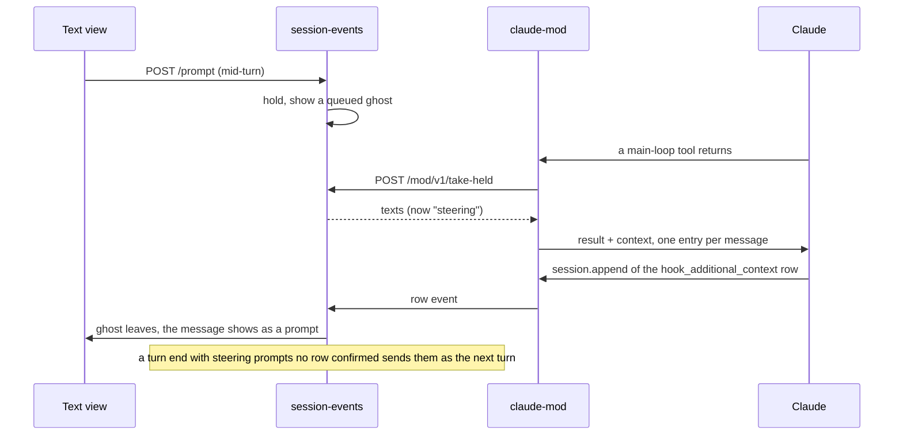

# A queued message steers the running turn

Viktor, 2026-10-10: *"let's make it steer similarly to how Claude code works. I
think now we send it only after the current turn but I want to be able to steer
/grill-with-docs"*, and on the same day, *"let's make sure we can still discard
the message. also let's allow editing the queued message. press and hold should
open an edit form"*.

Until now a message sent from the Text view while Claude's main turn ran was
held by session-events and sent when the turn ended (ADR-0036, amended
2026-10-05). Claude Code itself handles a message typed in the pane mid-turn
differently: it delivers it at the turn's next tool boundary, and the model
reads it before its next step. Long research turns, like the ones
`/grill-with-docs` runs, could only be redirected from the pane.

## What we decided

| Question | Decision |
|---|---|
| When a queued message reaches Claude | At the running turn's next tool boundary, as Claude Code does with a typed one. With no boundary before the turn ends, it goes out as the next turn, as before |
| How it reaches Claude | The mod's `tool.call` hook attaches it to the finished tool's result as context, one entry per message |
| How the model reads it | Led by a line saying the person sent it while Claude worked, and to read it before the next step and change course if it asks |
| Who holds the queue | session-events, as before. The mod asks for what is held at each main-loop tool boundary; nothing is pushed to the mod |
| Discarding | Swipe, the ×, or Discard in the edit form. Works until Claude has the message |
| Editing | Press and hold (touch) or the pencil (mouse) takes the message back out of the queue into an edit form, as Up does in Claude Code's own box. Save sends the new text, Close puts the original back, Discard drops it |
| Where the delivered message shows | As the person's own bubble at the point in the conversation where Claude read it, opening a turn of its own, the same as a prompt Claude absorbed from the pane |
| Subagents | Unchanged: a subagent is still messaged through **Steer** (`$.session.send`) |
| Slash commands | Unchanged: never held, sent to the mod at once |

## How it works

`$.prompt.submit` cannot do this: the plugin API runs a plugin's prompt once
Claude is idle. A `tool.call` hook's result can carry `context`, which the
model reads right after the tool's result. Measured on Claude Code 2.1.296 in a
scratch session: a message attached during the second of six sleeps made Claude
stop after the third. The engine stores the context as an attachment row,
`hook_additional_context` from `tool.call`, which reaches the mod's
`session.append` hook with door `hook-context` (the entries joined by newlines
inside one system reminder) and the transcript file with one content entry per
message. sessionio reads both shapes (`sessionio/steermain.go`), and finds the
lobby's entries by their lead line, since the row names the hook's event but
not the plugin, and the mod's plan feedback rides in the same row.

A message the mod has taken is **steering** until that row arrives. The take
alone does not prove the context will land: the mod waits at most 1.5 s for
session-events, and a call can end in a way that carries no context. So until
the row confirms it, a steering message is treated as still held in every way
that matters for not losing it:

- the turn's end sends it as the next turn, as it sends anything held;
- a Stop that asks for the queue hands it back, so it never runs after a Stop;
- the held file keeps it across a session-events restart.

It cannot be cancelled or edited: Claude may already have it, and the view
says so. The mod takes nothing for a subagent's call, a denied call (a denial
carries no context), an interrupted one, or its own dialog. Claude stores the
row before the turn ends, and session-events folds the mod's events in order,
so by a turn's end a delivered message has been confirmed. Confirmation counts
messages rather than matching text, because the row's copy of a long paste is
capped.

The edit form takes a message out of session-events' queue through the
existing `cancel-queued` route and sends the result through `POST /prompt`, so
Claude cannot take a message while it is being edited. An edited message goes
to the back of the queue. The form opens as the hold fires, before the server
answers, and is focused from the gesture that ends the hold, since iOS raises
the keyboard only for a focus inside a gesture. Its buttons wait for the
server. When Claude had the message already, the form closes, or, when
something was typed, offers to send the words as a new message. One message is
edited at a time. Once taken out, the draft is kept in the browser, so a
reload does not lose it.

## Compatibility

- A mod older than 0.6.0 never asks, so its sessions keep sending held
  messages at the turn's end. A mod change reaches only Claude processes
  started after it ships.
- A mod against a session-events without the route gets a 404, and stops
  asking until its next hello.

## Limits

- A message waits for the current tool to finish. If Claude is inside a
  ten-minute command, the message lands when that command returns, the same as
  a message typed in the pane.
- A turn that writes text without calling a tool has no boundary, so a message
  sent then goes out as the next turn.
- Several calls Claude already queued in one reply run before it reads the
  message.

## Open questions

- Pictures attached to a queued message travel as file paths in its text, as
  they did before; the context carries text only.
