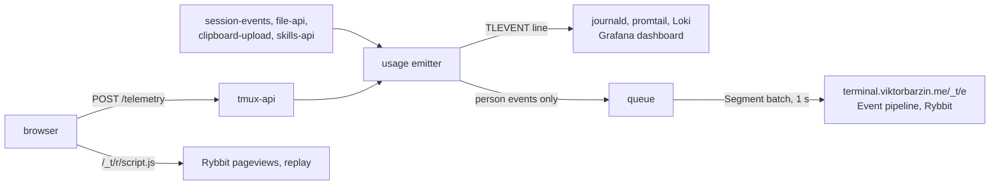

# Usage events a person causes also reach the Event pipeline

Status: accepted 2026-11-09. Extends
[ADR-0006](0006-usage-telemetry.md) and
[ADR-0008](0008-client-diagnostics.md).

Viktor asked for one analytics pipeline across every app he runs (infra
ADR-0041). Its standard covers three things: Product events in the Segment
spec, sent to the homelab's Event pipeline and kept in Rybbit; JSON log lines
with OpenTelemetry field names; and errors reported to GlitchTip through a
Sentry SDK. The lobby already records what people do (ADR-0006), so this
record says how that record joins the standard, what moves, and what stays
where it is.

## What we decided

| Question | Decision |
|---|---|
| Which events | 78 of the catalog's 126 names, the closed list in `telemetry/product.go`: things a person did, and real state changes. `claude.state_changed` is one: session-events emits it on a transition only, never on a repeated stamp |
| Which do not | Diagnostics (ADR-0008), load and stream timings, sweeps (`session.grid_repinned`, `session.grid_sized`, `session.autonamed`), errors (`app.error`, `api.*`), the mod's lifecycle, the iOS tap-chain records, and `share.guest`, which fires per guest write. They are Ops telemetry and stay in the journal |
| Whose | Nothing from a System session (the drop rule already keeps those out of the journal) and nothing tagged `tl.caller`: a Caller's turns are a program's work, not a person's |
| How | The usage emitter forwards after it writes the journal line. One goroutine per service sends through the telemetry library (`github.com/ViktorBarzin/telemetry/go`), from a queue of 1,024; when the queue is full an event is dropped, so a request never waits on analytics |
| Where to | `https://terminal.viktorbarzin.me/_t/e`, the public Ingest path. The devvm cannot resolve the pipeline's cluster Service name, and the Ingest path carries no forward-auth |
| Names | Unchanged, except seven whose verb was not past tense (table below). The journal keeps the old names, so no existing query changes |
| Properties | Each `tl.*` attribute without the prefix, in snake_case (`tl.idleSeconds` becomes `idle_seconds`, `tl.eng.missing` becomes `eng_missing`), JSON scalars only, strings cut at 256 bytes, and keys dropped from the end of their sorted order until the whole is under the pipeline's 2,048 characters. Each event also carries `service`, the service that sent it |
| Person | The Authentik hashed user id, which Traefik's forward-auth sends as `X-Authentik-Uid` (`TL_PERSON_HEADER`). `authuser` reads it for the real caller, never the act-as target, and each service holds it per OS user in memory |
| anonymousId | The browser's `tl.device` id when the event has one, otherwise a stable hash of the OS user (`AnonymousFor`). When a service first learns a Person id it sends one identify under that hash, which joins the events it sent before it knew |
| Logs | The library's slog handler, as JSON on stdout. `log.Printf` calls go through it unchanged, because `slog.SetDefault` redirects the standard logger |
| Journal markers | `TLEVENT` and `TLDIAG` lines keep their text shape, `2006/01/02 15:04:05 TLEVENT {...}`, on stderr through a logger of their own. Wrapped inside a JSON record, the dashboard's queries would parse nothing |
| Errors | sentry-go with the same-origin DSN `https://<key>@terminal.viktorbarzin.me/_t/x/3`, release = the build id, tagged with the service. `telemetry.ReportPanics` sends a handler's panic and panics on, so net/http logs it as before |
| Browser | `frontend-v2/src/telemetry/analytics.ts` adds Rybbit's script on `terminal.viktorbarzin.me` only, with password fields masked in replay; `/whoami` returns the caller's `person`, which the page hands to `rybbit.identify` |
| Public links | `link.html` carries the meta opt-out and no script. Its address holds the link's bearer token in the fragment, and a replay would record the shared conversation |
| Configuration | `TELEMETRY_WRITE_KEY`, `TELEMETRY_HOST`, `TELEMETRY_ENVIRONMENT` and `SENTRY_DSN` in `/etc/terminal-lobby.local.conf`, which infra's `playbooks/devvm.yml` writes from Vault. All unset is the default, and sends nothing |

Renamed on the way out:

| Catalog name | Product event |
|---|---|
| `palette.action` | `command.dispatched` |
| `browser.panel_open` | `browser.panel_opened` |
| `browser.take_control` | `browser.control_taken` |
| `browser.hand_back` | `browser.control_returned` |
| `browser.copy`, `browser.paste` | `browser.copied`, `browser.pasted` |
| `notify.opt_in` | `notify.opted_in` |
| `terminal.softkey`, `terminal.gesture` | `terminal.softkey_pressed`, `terminal.gesture_used` |

## What moved and what stays

The journal record is unchanged. Every event is still written as a `TLEVENT`
line, the Terminal Lobby Usage dashboard still reads them, and the catalog
in `telemetry/events.go` is still what decides whether a name exists. What
is new is a second copy of a subset in Rybbit, where events are kept with no
end date, sit beside the other apps' under the same Person, and can be read
as funnels and retention. Diagnostics stay journal-only. Retiring the
dashboard's duplicated panels is a later decision (infra ADR-0041,
rollout step 5).

## Considered options

- **Forward only four to eight events**, the number the rollout brief gives
  other apps. The lobby already has a curated vocabulary of person actions,
  and Viktor asked for its events to move onto the standard, so the line
  drawn is person action versus Ops telemetry rather than a short list.
- **Read the TLEVENT lines back out of Loki and forward them from the
  cluster.** No change on the box, but it would add a reader to a store with
  30 days of retention and a shared stream cap, and Loki has had a gap on
  this job before. Emitting at the source keeps one path.
- **A static OS user to Person id map, written by the playbook.** It would
  name a Person on events from before the first request, at the cost of an
  Authentik API lookup in infra. The per-request header plus one identify
  covers the same events without a second source of identity.
- **The cluster Service, `event-pipeline.rybbit.svc.cluster.local`.** It is
  not resolvable from the devvm, and routing the box into the cluster's
  Service network for one client is more than the Ingest path costs.

## Consequences

- Adding a usage event now also means deciding whether it is forwarded: add
  it to `productNames` in `telemetry/product.go` when a person causes it.
  `TestEveryForwardedNameIsCataloguedAndPassesTheStandard` checks the name
  against the pipeline's pattern.
- Events queued in the last second before a service restarts can be lost;
  the send interval is one second rather than the library's five for that
  reason. session-events flushes on shutdown, the other services exit through
  `log.Fatal` and do not.
- The Go modules that import `telemetry` now need Go 1.25, which the library
  needs. CI's `setup-go` installs the stable release; the Dockerfile's build
  stage moved to `golang:1.25-bookworm`.
- A service that has seen no request since it started sends a person's events
  under the hashed anonymousId until it does. The identify it sends then
  joins them, so they are attributed after a short delay rather than lost.

## Open questions

- Session replay records what the page shows, with only password fields
  masked, and the Text view shows the conversation. ADR-0006 keeps
  conversation content out of telemetry; replay is the standard's setting,
  applied here as given. Whether the lobby should mask more (Rybbit's
  per-site replay settings, or a text mask on the transcript) is a decision
  for Viktor.
- Rybbit's own pageviews and the Product events share a Person only once
  the page has called `rybbit.identify`. How Rybbit merges the browser's
  anonymous visits into that Person is the platform's behaviour and was not
  measured here.
