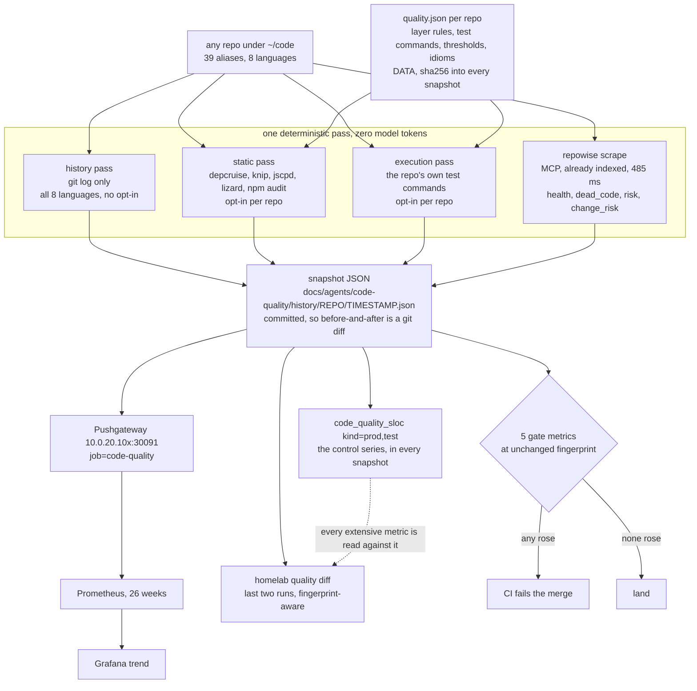

# Code quality measurement for ~/code

Status: proposal, awaiting decisions in "Open questions".
Author: research pass 2026-09-06, over `/home/wizard/code/terminal-lobby` at `7fca546`.
Scope: what to measure across every repo in `~/code`, and one command that records it.

## The answer

Measure **history and execution, not source text**. Seven things earn a tracked
series: change concentration, invisible change coupling, declared-layer
violations, suite status and runtime skips, unused exports and unlisted
dependencies, production-scoped vulnerabilities, and repowise's dead-code high
tier. Five of those get a CI gate. Everything from the complexity family
(cyclomatic, cognitive, nesting, Halstead, NPath) goes on a trend line at most,
because on this codebase summed cyclomatic complexity correlates with summed
length at r = 0.910 (measured here, n = 578 files) and it is the number that
already lied about the refactor that provoked this work. Ignore every composite
score: maintainability index, SQALE technical debt ratio, and the
test-to-production line ratio all move the wrong way when code is deleted, and
Borg, Ezzouhri and Tornhill (2024) measure a naive LOC threshold at AUC 0.95 on
the field's own labelled dataset, above every composite they tested. Cost is
about 70 seconds of static work and 200 seconds of test work per repo, zero
model tokens, and roughly two thirds of it is already computed by repowise,
which is self-hosted here and returned a fresh index for terminal-lobby in 485 ms
during this research.

## Why line count lied

The 26-branch refactor that provoked this, measured before and after:

| measure | before | after | move |
|---|---|---|---|
| production lines | 93,570 | 95,492 | +1,922 |
| test lines | 96,053 | 100,926 | +4,873 |
| refactor commits alone | 2,257 deleted | 2,616 added | +359 |

The code got better. Dead symbols went to zero references, a duplicated storage
guard went from 29 files to 18, five silently dropped telemetry events were
fixed, and the repo gained its first linters. Every size-shaped number went the
other way.

The trap generalises past raw lines. I re-ran the same before-and-after with
cyclomatic complexity, which is the metric most teams reach for next:

| form | before | after | verdict |
|---|---|---|---|
| summed CCN over the repo | 18,101 | 24,299 | tracked LOC exactly, told the same wrong story |
| mean CCN per function | 2.455 | 2.297 | fell 6.4%, the right direction |
| complexity density (sumCCN / NLOC) | 0.2721 | 0.2694 | fell, the right direction |

Measured with lizard over `git archive` extracts of `32177c3` (parent of the
first refactor commit) and `HEAD`. Two caveats that belong with the numbers.
The window includes a merge from origin, not only the 26 refactor branches, and
a falling mean can also come from adding small test helpers, so this
establishes direction rather than magnitude. And the lizard run silently skipped
118 `.tsx` files totalling 38,203 lines, `TerminalNative.tsx` among them, so it
saw 71% of the codebase on both sides of the comparison. Since the 26 branches
were substantially frontend work, that caveat cuts against the complexity
result rather than for it.

The lesson is the intensive-versus-extensive distinction, not "cyclomatic
complexity is fine after all". Any metric whose numerator grows with the code
will report a growing codebase as a decaying one. Ratios, percentiles and
counts-over-threshold with a paired denominator survive that. Sums do not.

## What survives

Verdicts below carry the adversarial pass's corrections, which downgraded eight
entries the first pass had marked adopt. "Beats LOC" means the metric predicts
defects, change cost, review time or regression risk **better than lines of code
alone**, on evidence that controlled for size. It is a high bar and most of the
field does not clear it.

### Adopt

| metric | what it measures | beats LOC | evidence | tool | languages |
|---|---|---|---|---|---|
| Change frequency (commits per file, 90d) | how often a file is edited | yes | Rahman and Devanbu 2013 (ICSE), 54 code metrics vs 14 process metrics over 85 releases of 12 projects, process wins and code metrics stagnate release to release; Kamei et al. 2010 (ICSM) re-tested under effort-aware evaluation and the finding held; replicated by Majumder, Menzies et al. 2020 over 722,471 commits | `git log`, ~15 lines of Python; repowise emits `commit_count_90d` | all eight, it reads paths not content |
| Temporal / change coupling | files that keep changing together, normalised by the less-changed file | yes | D'Ambros, Lanza and Robbes 2009 (MSR) found change coupling competitive with and complementary to source metrics; Gall, Hajek and Jazayeri 1998 (ICSM) is the origin; Zimmermann et al. 2005 (IEEE TSE) report ~33% precision at top-3 as a navigation aid, which is the honest framing | `git log --name-only` plus filtering; repowise emits `co_change_partners` with a `has_import_link` flag and a `co_change_scatter` biomarker | all eight, and it is the only metric that crosses language boundaries |
| Declared layer violations | import edges breaking a hand-written allow/deny rule between directories | yes, on local evidence | No RCT-grade study for conformance rules as such. Indirect: Oyetoyan, Cruzes and Conradi 2013 (JSS) and Oyetoyan, Falleri, Dietrich and Jezek 2015 (SANER) on cyclic and inverted dependencies concentrating defects. The direct evidence is local and strong, see "What this would have caught" | dependency-cruiser (MIT) for TS/JS/Svelte, import-linter (BSD) for Python, depguard inside golangci-lint for Go | TS, TSX, JS, Svelte, Go, Python, Rust. Not shell, Terraform or Vimscript |
| Suite status, termination, runtime skips | does the suite pass, does every module terminate, how many tests skipped at runtime on this host | yes | DORA lineage (Forsgren, Humble and Kim 2018) ties automated testing and fast feedback to change failure rate. Herzig and Nagappan 2015 (ICSE) on the cost of false alarms was not verified within budget, so treat it as unverified rather than disputed | the repo's own test commands, zero install | every language and every harness, including the shell and Python harnesses no other metric here reaches |
| Unused exports and unlisted dependencies | exported symbols with no importer; used-but-undeclared packages | unevidenced for the export count; the unlisted-dependency count is a binary fact | Eder et al. 2012 (ICSE SEIP) argued unused code draws real maintenance effort, cited from prior knowledge rather than a fetched source. No study links unused-export count to defect rate. Its value is the ratchet property: monotone, deletable, locally verifiable | knip 5 (ISC), already wired into this repo's CI at `frontend-v2/knip.jsonc` | TS, TSX, JS, Svelte. Not Go, Python or Rust |
| Production-scoped vulnerable dependencies | known-vulnerable packages counted over what actually ships | yes, and size control is not the applicable test because the outcome is exploitable exposure | Pashchenko, Plate, Ponta, Sabetta and Massacci, ESEM 2018 and IEEE TSE 2020 (Vuln4Real): naive dependency-level counting substantially over-inflates; filtering development-only dependencies is the first correction | `npm audit --omit=dev`, `govulncheck` (adds call-graph reachability, not installed here), `pip-audit`, `cargo-audit` | Go, TS/JS/Svelte, Python, Rust. Not shell or Terraform |
| Dead code, high confidence tier | unreachable files, unused exports, zombie packages, tiered by confidence | not a proxy, so no correlational evidence needed | "Zero references" is a fact about the code, checkable by deleting the symbol and building | repowise `get_dead_code`, already indexed | Go, TS, TSX, Python, JS confirmed; shell appears with low confidence, correctly |
| Churn x complexity hotspot ranking | files that both change often and are hard | yes for the churn half | Nagappan and Ball 2005 (ICSE) predicted defect density from relative churn at Microsoft; Rahman and Devanbu 2013 as above. Tornhill and Borg 2022 (TechDebt) report 15x defects and 2x resolution time in low-health code across 39 proprietary codebases, but the health score is CodeScene's own composite and the authors work for the vendor, so treat the effect size as unreplicated | repowise `get_health(include=["churn_complexity"])`, already computed | churn half is language-blind; `max_ccn` inherits repowise's parser coverage |
| Duplication percentage | share of lines inside a token-level clone | no, and record it anyway as context | Juergens, Deissenboeck, Hummel and Wagner 2009 (ICSE) found inconsistent clones do correlate with faults but most clones are harmless; Rahman, Bird and Devanbu 2010 (MSR) / 2012 (EMSE) found cloned code is **less** defect-prone than non-cloned code. Defensible as a design signal, not as a defect predictor | jscpd 4 (MIT), not installed | ~150 formats including Go, TS, TSX, Python, JS, CSS, Rust, HCL. Svelte partial |
| `code_quality_sloc` (the control) | production and test lines, separately | it **is** the baseline | Borg, Ezzouhri and Tornhill 2024 (ICSME) benchmark a naive LOC threshold at AUC 0.95 on MainData, above every composite they tested including SonarQube's | `wc -l` with an explicit, fingerprinted file-selection rule | all eight |

The last row is the point of the whole design. LOC is not the weak baseline to
be beaten, it is the bar. Recording it beside everything else is what stops a
future metric from being a rename.

### Trial

Recorded in the snapshot, pushed to Prometheus where noted, never gated. Grouped
by why they are on trial rather than adopted.

**Evidence did not survive the size control.**

| metric | the correction |
|---|---|
| Cognitive complexity per function | Lavazza, Abualkishik, Liu and Morasca, JSS vol. 197 (2023), article 111561, was designed to test exactly this and found Cognitive Complexity does not significantly outperform traditional measures including LOC and McCabe. Repowise already computes it for Go, TS and TSX, so it costs nothing. Track p95 and count-over-15, read out of repowise |
| Cyclomatic complexity per function | Landman, Serebrenik, Bouwers and Vinju 2016 (JSEP) measured 17.6M Java methods and 6.3M C functions and concluded the correlation "is not strong enough to conclude that CC is redundant with SLOC" (R2 0.40 Java, 0.44 C). Shepperd 1988 (Software Engineering Journal 3(2):30-36) argues the opposite. Genuinely contested. Measured here per function r = 0.697, corrected for the .tsx blind spot R2 = 0.4209 |
| Max cyclomatic complexity per file | Ranking 580 files by max CCN gives precision@20 of 17/20 against size's 16/20, but concentration over the top 20% is 0.3238 against size's 0.4066. Better at the very top, worse across the band |
| Mutation score | Papadakis, Shin, Yoo and Bae 2018 (ICSE) found all correlations between mutation score and real fault detection weak once test suite size is controlled. Just et al. 2014 (FSE) controlled for coverage, which is not the size confound. Emit the survivor list, never a score gauge |
| Statement coverage | Inozemtseva and Holmes 2014 (ICSE) and Kochhar, Lo, Lawall and Nagappan 2017 (IEEE Trans. Reliability, 100 large Java projects) both say no once size is controlled. Defensible only as a floor detector, and only with a low threshold rather than exactly 0.0, because `release/cmd/tl-users` sits at 3.4% |
| JIT change risk (Kamei features) | Yang et al. 2016 (FSE) found simple unsupervised rankers on a single change metric outperform Kamei's supervised model under effort-aware evaluation, which is the size control. Fu and Menzies 2017 (FSE) push back, so it is disputed. Trial it with the comparison nobody ran: rank commits by repowise percentile against lines-added alone and see whether the orderings ever disagree. Lines-added contributes +3.66 against -0.51 to +0.63 for every other feature, about six times the next weight |
| Afferent coupling (fan-in) | El Emam, Benlarbi, Goel and Rai 2001 (IEEE TSE 27(7):630-650) found code size accounted for **all** the significant variation. Measured independent of size here (Spearman rho 0.130 with LOC) but independence is necessary, not sufficient. Nobody has defined what a fan-in regression looks like: rising fan-in on a 55-line utility is reuse, not decay |

**Unevidenced, cheap, kept for the shape they give a reviewer.**

| metric | note |
|---|---|
| Max nesting depth per function | No primary study isolates it independent of size. Free from repowise (`max_nesting`, plus a `bumpy_road` biomarker that is the sharper instrument). Track as a count of functions deeper than 4, labelled unevidenced |
| Import cycles | Measured 2 cycles in 3 of 178 frontend files (1.7%). Structurally always zero for Go, since the spec forbids them, so do not emit a `lang="go"` series. Free rider on the dependency-cruiser install, one boolean rule, no second tool |
| Propagation cost and core size | MacCormack, Baldwin and Rusnak 2010 (HBS WP 10-059) found 75-80% of 1,286 releases across 17 applications have a core-periphery structure, which is architecture description, not defect prediction. Measured 5.2% at file level and 94.1% at directory level on the same tree, so granularity is mandatory in the label |
| Runtime skip count per host | 57 conditional `t.Skip` gates keyed on host facts (tmux present, `/proc` readable, a second local account). Dormant on this workstation, armed in a CI container. Without it, coverage and pass-rate numbers are not comparable between machines |
| Idiom conformance (guarded vs raw call sites) | No literature base. The detector was written after seeing the refactor it then validates, which is selection on the dependent variable. Kept as a targeted regression guard for one named idiom, not as a metric that beats LOC. Note the floor: 3 of the 23 surviving `localStorage.` hits are inside the helper's own body, so it can never reach zero |
| Rework rate | Fix landing within 24h of a prior touch to the same file. The proxy's hit rate rises mechanically with commit density, and density tripled across the two windows measured (113 to 338 first-parent commits). Record the denominator beside it or the number is unattributable |
| Change entropy (Hassan 2009) | Report only, never target. Entropy penalises broad commits, so optimising for it means avoiding refactors, including the storage-guard dedup that touched 29 files |
| Prior defect count | Split-half out of sample, twice, on this repo: LOC captured 40% of the next window's fix-touches, prior fix count 31% and 26%, fixes-per-KLOC 19% and 22%, random 20%. That contradicts repowise's own directive text, which asserts recent defect history is the strongest predictor. Re-run in six months before believing either way |
| Test-only-reachable exported symbols | Raised by the adversarial pass with no verdict assigned. It is the exact class this refactor removed and no instrument tested catches it. Per Go package, count exported symbols whose only references live in `*_test.go` |
| Complexity density (sumCCN / NLOC) | Raised by the adversarial pass with no verdict assigned. Gill and Kemerer 1991 (IEEE TSE 17(12):1284-1288) validated it against maintenance productivity on a small pilot sample they labelled as such. It is the only member of the complexity family that is size-controlled by construction, and the only number in the whole research that moved in the direction the refactor actually went |
| Diff coverage | Raised by the adversarial pass with no verdict assigned. Its denominator is the diff, not the codebase, so it is structurally immune to the size objection. Needs no new binary in any language, only an intersection of covered line numbers against `git diff -U0` ranges |

### Hold

Measurable but uninformative here, or informative but unaffordable. Record
nothing; revisit if the stated precondition changes.

| metric | why it is held |
|---|---|
| SQALE index (remediation minutes) | Best-performing SonarQube metric in Borg et al. 2024 at AUC 0.86, and it still loses to a LOC threshold at 0.95. Needs a self-hosted JVM plus a database plus a scanner run per repo. Revisit only if SonarQube arrives for another reason |
| Code smell counts | Sjoberg, Yamashita, Anda, Mockus and Dyba 2013 (IEEE TSE 39(8):1144-1156) hired six professionals for three to four weeks each across four functionally equivalent Java systems: "None of the 12 investigated smells was significantly associated with increased effort after we adjusted for file size and the number of changes." Contested by Palomba et al. 2018 (EMSE, 395 releases across 30 systems), who found smelly files more change- and fault-prone. Sjoberg is better designed; n = 6 developers is not the last word. Note the category jump: Sjoberg's 12 are OO design smells, while golangci-lint and ruff emit correctness and style lint. Keep the linters, read the hits, never sum them into a gauge |
| Hotspot score (churn x size, Tornhill's product) | Measured rho 0.887 with LOC here, against 0.512 for plain change count, and it beats change count by 0.002 AUC. The multiplication by size reimports the exact failure this work exists to escape. Use the ranked list, do not push the aggregate |
| Change failure rate | 4 reverts in 938 commits (0.43%), three reverted within 6 minutes, one whose subject reads "wip(terminal): parked duplicate of the keyboard-hold fix, do not land". A git parking idiom, not a production failure. Measurable and uninformative because a single maintainer rebases rather than reverts |
| Defect density (fixes per KLOC) | Ostrand, Weyuker and Bell 2005 ran the size-control comparison against a largest-files heuristic and their model won, which is the most relevant fact in the paper. It did not replicate here, twice, out of sample |
| Dependency freshness (libyears) | Cox, Bouwers, van Eekelen and Visser 2015 (ICSE SEIP) found systems with outdated dependencies four times as likely to have security issues. It rises on its own with time and a bot that bumps everything drives it to zero while telling you nothing. Keep it beside the vulnerability count as its leading indicator, not as a series |
| Architectural propagation cost from repowise | Returns a perfect 10/10 for terminal-lobby on a 60-node workspace service graph while the repo's own health band is "warning". Module-level, not file-level, so it cannot see intra-repo structure |
| Bus factor and ownership concentration | Bird, Nagappan, Murphy, Gall and Devanbu 2011 (ESEC/FSE) is a strong study with a size control, and 719 of 719 attributed files here have bus factor 1 because it is a single-author repo. Zero variance. It earns its place across the other repos in `~/code` that have more than one contributor, not in this one |

### Reject

Do not build these. The schema should make several of them impossible to emit.

| metric | why |
|---|---|
| Summed or file-aggregated cyclomatic complexity | Measured here: per function r = 0.697 R2 = 0.486; sum the identical numbers per file and r = 0.910 R2 = 0.828, rising to 0.9251 / 0.8559 once the .tsx blind spot is corrected. Aggregation manufactures the correlation. This is the number that already lied about the refactor |
| Maintainability index, original and Microsoft variants | Measured r(MI, ln SLOC) = -0.876 on terminal-lobby's Python (n = 15) and -0.787 across 369 files in `~/code`. The `-16.2 ln(sloc)` term means splitting a file raises MI for both halves, and the comment term maximises near 57 comment lines, buying up to +29 normalised points for prose. van Deursen 2014 documents coefficients fitted to 1980s HP systems in C and Pascal and never recalibrated. radon covers Python only, which is 2.4% of terminal-lobby's lines. The two variants are one rejection, not two: radon implements the identical 100/171 rescaling and the identical 20/10 band edges |
| SQALE technical debt ratio and the A-E rating | Borg et al. 2024 measure AUC 0.60 against a 0.50 coin flip, and at SonarQube's shipped default threshold the operating point plots below the ROC diagonal. The denominator is cost-per-line times LOC, so deleting 2,257 lines **raises** the ratio and the refactor reports as a regression |
| Halstead volume, difficulty, effort | Hamer and Frewin 1982 (ICSE 6) tested the underpinning relationships and found the majority "represent neither natural laws nor useful engineering approximations". Volume is a monotone transform of a token count, and r(token_count, NLOC) = 0.890 measured here across 10,579 functions. No maintained free tool computes it for Go, TypeScript or Rust |
| NPath | Nejmeh 1988 (CACM 31(2):188-200) proposes it and reports experience at AT&T Bell Labs. No independent replication, no defect-prediction study, no comparison against LOC. Unevidenced rather than discredited. Tooling coverage here is zero: PMD and Checkstyle are Java and Apex only, and this monorepo contains no Java |
| CK inheritance and cohesion (DIT, NOC, LCOM) | 4 class declarations across 178 non-test frontend files, 3 with `extends`. Go has no inheritance by language design. These are constants here. LCOM also fails the representation condition of measurement theory (Hitz and Montazeri 1996, IEEE TSE 22(4):267-271) |
| Martin's instability, abstractness and distance | Measured A ~ 0 for every shared Go package, which collapses D into 1 - I, so "distance from the main sequence" adds no information. Go interfaces are declared at the consumer, so the abstractness definition does not transfer |
| Branch and condition coverage | Inozemtseva and Holmes 2014 measured statement, branch and modified-condition coverage across the same 31,000 suites: "stronger forms of coverage do not provide greater insight into the effectiveness of the suite." Go emits no branch coverage at all, which rules it out for 14 of 14 modules regardless |
| Test-to-production line ratio | It is LOC divided by LOC. My count with different exclusions gives 1.16:1 against the brief's 1.06:1, a 9% move from a file-selection decision before any code changes |
| Lead time, recovery time, review latency | Measured: lead time median 0.00h with 98% of changes landing inside an hour; zero pull requests and one human author in 90 days. Pinned at their optimum or structurally empty |
| repowise `weighted_deficit` / `share_of_repo_gap_pct` | Defined as score-points times NLOC. The tool's top directive names `frontend-v2/test/TerminalNative.wiring.test.tsx` as 31.8% of the repo's whole health gap, because at 5,491 lines it is the largest file in the repo, and it is a test file. Keep it as a work-queue sort, never as a series |
| Gapped and semantic clones (Type-3, Type-4) | This is where the Juergens et al. 2009 fault signal lives, and no free tool detects it. Sweeping jscpd across strict, mild and weak modes moves only comment handling, never gap tolerance, so the whole sweep stays inside Type-1/2 |

## What the adversary killed

These are the ones a future reader will otherwise re-propose. Each was argued
for, and each lost on a checkable fact.

| claim | what checking it found |
|---|---|
| Cognitive complexity beats LOC | The headline was misquoted. Muñoz Barón, Wyrich and Wagner 2020 (ESEM) pool to 0.54 for comprehension time and **-0.29** for perceived understandability, not 0.654 and 0.411. The 0.65 is a single study's row in a forest plot. The ratings figure was wrong in sign, and the sign is the meaningful part. Worse, Lavazza et al. 2023 ran the head-to-head against LOC and McCabe and found no significant advantage. That paper was in the search results and went unread while adopt was recorded |
| Fan-in and CK metrics survive a size control | El Emam, Benlarbi, Goel and Rai 2001 was cited for "only 4 of 24 metrics remained, coupling fared better". That finding is not in that paper. What it concludes is that code size accounted for **all** the significant variation. The paper was cited for the wrong finding, and the wrong finding was the more favourable one. The 24-metric figure belongs to El Emam, Melo and Machado 2001 in JSS, a different study |
| Coverage has a defect counterweight | Kochhar, Thung and Lo 2015 (SANER) was cited as finding a negative correlation with post-release defect density. It examined 67 and 92 real bugs in two projects using Randoop-generated synthetic suites and found a **positive** correlation with bug-detection effectiveness. The paper that does study post-release defects is Kochhar, Lo, Lawall and Nagappan 2017 (IEEE Trans. Reliability) and its result is a size-controlled null |
| Mutation score is confounded only by suite size a little | Papadakis, Shin, Yoo and Bae 2018 (ICSE) found **all** correlations weak when controlling for suite size, on the same Defects4J corpus. Softening the one paper that refutes the headline |
| DORA retired change failure rate | dora.dev's own guide publishes five metrics with change fail rate **and** deployment rework rate both under stability. Rework rate is an addition, not a replacement. Two separate verdicts rested on a retirement that did not happen, both inherited from one secondary source that was never checked against the publisher |
| Test hygiene is saturated, zero skips | `grep -rn 't\.Skip'` returns 57 call sites across file-api, tmux-api, release, sessionio and authuser, all keyed on host facts. The claimed zero was the sole basis for a verdict, and it was repeated in a second claim's summary |
| The 26-branch refactor's dead code was provably caught | repowise indexes HEAD only, so the before tree cannot be queried. The decisive claim reasoned by analogy from a different symbol. Separately, "callsites=0 in both" for `skillscan.Copy/Compare/Diff` is contradicted by `copy_test.go:22,67,90,111` |
| Graylin et al. 2009 | The first author is Graylin **Jay**; "David, Adams and Sharif" splits David P. Hale in half and invents two authors. Carried through two separate claims |
| Landman et al. supports discarding CC | Their stated conclusion is that CC is **not** redundant with SLOC, which is the opposite polarity to how it was deployed. The method-level corpus is ~17M, not 17.6M, and the "log-transformed to 0.87" figure is in a table summarising other people's studies, not in their own results |
| Campbell 2018 is an unreviewed white paper | It is a published paper at TechDebt '18 (ACM, doi 10.1145/3194164.3194186). The SonarSource white paper is the December 2016 document. The claim merged them and then denied the peer review the 2018 one had |
| Assorted venue errors | Vuln4Real 2020 is IEEE TSE, not EMSE. Krinke 2008 is SCAM, not CSMR. arXiv 2306.16171 does not name Type-4 detection as unsolved at scale; its stated challenges are datasets, empirical evaluations, hybrid methods and multi-paradigm languages |
| Luo et al.'s top two flake causes | Async wait, **concurrency**, then order dependency. The claim named the first and third and then asserted the local finding matched that shape |
| The lizard measurement covered the codebase | `cut -d, -f7` over the CSV returns `.ts`, `.go`, `.py` and nothing else. 118 `.tsx` files and 38,203 lines were absent, including `TerminalNative.tsx`. The survey saw 71% of the code. Correcting it makes the argument against summed complexity stronger, not weaker |

One structural correction that changes the design rather than a citation. Suite
health and flake rate were argued as two metrics and rest on the same two
observations (three frontend failures, the sessionio hang). Adopting both would
put one fact in the snapshot twice. Flake rate folds into suite health as a
sub-field, and earns its own series only once it computes a rate over N repeated
runs and names which tests flipped.

## The pipeline



## The design

Copied from `homelab reflect`, not invented alongside it. Read
`/home/wizard/code/docs/agents/session-reflection/README.md` before changing
anything structural here.

### The verb

```sh
homelab quality run [repo...]      # collect, record, push, print the delta
homelab quality diff [repo]        # last two runs, side by side, fingerprint-aware
homelab quality history [repo]     # every recorded run
homelab quality gate [repo]        # exit non-zero if a gate metric regressed
homelab quality run --json --no-push --no-record --no-tests
```

`run` with no argument walks every repo under `~/code` that has a
`quality.json`, plus the history pass for every repo that does not, since the
history pass needs no configuration and works on all eight languages. `gate` is
what CI calls. It re-uses the last snapshot if one exists for the current SHA
and collects otherwise, so a gate run in CI costs one pass, not two.

Code lives at `docs/agents/code-quality/` in the monorepo, mirroring
`docs/agents/session-reflection/`. Snapshots go to
`docs/agents/code-quality/history/<repo>/<timestamp>.json` and are committed.
Nothing else is.

### The snapshot

One file per repo per run. Every number carries the context needed to compare it
with the same number from another machine or another toolchain version.

```json
{
  "recorded_at": "2026-09-06T10:14:03.221Z",
  "repo": "terminal-lobby",
  "commit": "7fca5463c68b",
  "config_fingerprint": "a13f0c94e2b7",
  "tool_versions": {
    "lizard": "1.17.31", "jscpd": "4.0.5", "knip": "5.62.0",
    "dependency-cruiser": "16.10.4", "repowise_index": "7fca5463c68b",
    "go": "1.24.2", "node": "22.14.0"
  },
  "host_capabilities": {
    "fingerprint": "b7e1", "tmux": true, "proc_readable": true,
    "second_local_account": true, "symlinks": true
  },
  "control": { "sloc_prod": 95252, "sloc_test": 100926, "files_prod": 315 },

  "history": {
    "window_days": 90,
    "commits": 1093,
    "change_concentration_top10": 0.31,
    "invisible_coupling_pairs": 22,
    "max_coupling_degree": 1.0,
    "change_entropy_p90": 3.83,
    "bug_magnet_files": 5,
    "rework_rate_pct": 26.3,
    "first_parent_code_commits": 453
  },

  "structure": {
    "layer_violations": [
      {"rule": "store-not-to-components",
       "from": "src/store/lobby.ts", "to": "src/components/lobby.logic.ts"}
    ],
    "layer_violations_total": 3,
    "import_cycles": {"ts": 1},
    "files_in_cycles_pct": 1.7,
    "propagation_cost_pct": {"granularity": "file", "value": 5.2},
    "fan_in_p95": 14, "fan_in_max": 23
  },

  "deadcode": {
    "unused_exports": 51, "unused_exports_ignored_files": 28,
    "unlisted_deps": 0, "unused_dev_deps": 1,
    "repowise_high_tier_findings": 4, "repowise_high_tier_lines": 275,
    "test_only_exports": null
  },

  "supply_chain": {
    "vuln_prod": {"critical": 0, "high": 0, "moderate": 2, "low": 0},
    "vuln_all":  {"critical": 1, "high": 2, "moderate": 3, "low": 0},
    "deps_total": {"prod": 234, "dev": 286, "optional": 86},
    "deps_outdated": 16
  },

  "tests": {
    "modules": [
      {"name": "sessionio", "status": "timeout", "wall_clock_s": 90.02,
       "runtime_skips": 0, "coverage_pct": 75.2},
      {"name": "slug", "status": "pass", "wall_clock_s": 0.015,
       "runtime_skips": 0, "coverage_pct": 98.1},
      {"name": "frontend-v2", "status": "fail", "wall_clock_s": 164.36,
       "runtime_skips": 4, "coverage_pct": null,
       "failed": ["test/notifications.coldtap.test.ts",
                  "test/FilePreview.editor.test.tsx"],
       "passed_in_isolation": true}
    ],
    "suites_green": 12, "suites_total": 15,
    "flake_runs": 1, "flake_candidates": 3
  },

  "complexity": {
    "by_lang": {
      "go":  {"functions": 4378, "cognitive_p95": 22, "cognitive_over_15": 36,
              "max_ccn_p95": 14, "nesting_over_4": 9, "density": 0.271},
      "tsx": {"functions": 4289, "cognitive_p95": 18, "cognitive_over_15": 41,
              "max_ccn_p95": 11, "nesting_over_4": 6, "density": 0.216}
    },
    "source": "repowise"
  },

  "duplication": {
    "overall_pct": 1.52,
    "by_format": {"javascript": 7.54, "tsx": 2.23, "go": 0.95, "typescript": 0.78},
    "thresholds": {"min_lines": 8, "min_tokens": 60},
    "coverage_note": "css partial: 453 of 4836 app.css lines parsed"
  },

  "idioms": {
    "localStorage_raw_callsites": 23,
    "localStorage_helper_floor": 3
  },

  "collection": {
    "wall_clock_s": {"history": 6.1, "static": 68.4, "tests": 201.7, "repowise": 1.9},
    "skipped_passes": [], "errors": []
  }
}
```

Three fields carry more weight than they look. `config_fingerprint` is a sha256
over the merged `quality.json`, exactly as `patterns_fingerprint` works in
session-reflection, and `diff` refuses to call anything a regression across a
fingerprint change. `host_capabilities` exists because 57 conditional `t.Skip`
gates make coverage and pass counts host-dependent, so the same commit yields
different numbers in a CI container. `tool_versions` exists because repowise
reports `max_ccn` 71 for `timeline.logic.ts` where lizard reports 53, and a
trend that moves when the parser changes is worse than no trend.

### Prometheus

`job=code-quality`, same Pushgateway NodePorts session-reflection already uses
(`10.0.20.100-103:30091`). Every series carries `repo`.

Gauges, gated:

```
code_quality_layer_violations{repo,rule}
code_quality_suite_status{repo,module}                  # 1 green, 0 red
code_quality_unlisted_deps{repo}
code_quality_vuln_prod{repo,severity}
code_quality_dead_high_tier_findings{repo}
```

Gauges, trend only:

```
code_quality_sloc{repo,kind}                            # kind=prod|test, the control
code_quality_change_concentration_ratio{repo}
code_quality_invisible_coupling_pairs{repo,min_degree}
code_quality_max_coupling_degree{repo}
code_quality_bug_magnet_files{repo}
code_quality_change_entropy_p90{repo}                   # report only, never a target
code_quality_rework_rate_pct{repo}
code_quality_first_parent_commits{repo}                 # rework's denominator
code_quality_suite_duration_seconds{repo,module}
code_quality_suite_runtime_skips{repo,module,host_caps}
code_quality_coverage_statements_pct{repo,module,host_caps}
code_quality_unused_exports{repo}
code_quality_unused_exports_ignored_files{repo}         # the anti-hiding guard
code_quality_dead_high_tier_lines{repo}
code_quality_vuln_all{repo,severity}
code_quality_deps_total{repo,scope}
code_quality_deps_outdated{repo}
code_quality_duplication_pct{repo,format}
code_quality_cognitive_p95{repo,lang}
code_quality_cognitive_over_15{repo,lang}
code_quality_functions_total{repo,lang}                 # exposes the split-a-function dodge
code_quality_complexity_density{repo,lang}
code_quality_max_ccn_p95{repo,lang}
code_quality_nesting_over_4{repo,lang}                  # labelled unevidenced
code_quality_fan_in_p95{repo}
code_quality_fan_in_max{repo}
code_quality_import_cycles{repo,lang}                   # never emit lang="go"
code_quality_files_in_cycles_pct{repo}
code_quality_propagation_cost_pct{repo,granularity}     # granularity is mandatory
code_quality_idiom_raw_callsites{repo,idiom}
code_quality_change_risk_p90{repo}
code_quality_config_fingerprint_info{repo,fingerprint}  # always 1
```

Series the schema must refuse to emit, because each is a size proxy wearing a
score: summed or average cyclomatic complexity, maintainability index in any
variant, technical debt ratio, test-to-production ratio, `weighted_deficit`,
`hotspot_score` as an aggregate, bus factor on a single-author repo.

### What a regression looks like

The general rule first. **An extensive metric that rose while
`code_quality_sloc` rose proportionally is growth, not decay.** `diff` prints
the control move beside every other move and refuses to flag a size-shaped
metric that tracked it. Intensive metrics (ratios, densities, percentiles,
counts-over-threshold with a paired denominator) stand on their own.

| metric | regression |
|---|---|
| `layer_violations` | any increase at unchanged fingerprint. A rule deleted shows as a fingerprint change, not an improvement |
| `suite_status` | 1 to 0 on any module. Also `timeout` appearing in the snapshot's `status` field |
| `unlisted_deps` | anything above 0 |
| `vuln_prod` | any critical or high above 0. A rise in `vuln_all` alone is context, since an advisory landing is not a change in your code |
| `dead_high_tier_findings` | any increase. Note the concentration risk: 259 of the current 275 lines are one symbol, so this series moves 94% on a single deletion |
| `change_concentration_top10` | rises. Work is piling into the same files |
| `invisible_coupling_pairs` | rises, or a degree-1.00 pair appears. A degree-1.00 pair is a duplicated file, which is what `sw.js` looked like |
| `suite_duration_seconds` | more than 25% run-over-run. Labelled unevidenced, because the paper cited for the mechanism does not contain it |
| `suite_runtime_skips` | rises at an unchanged `host_caps` |
| `coverage_statements_pct` | a module dropping, or entering the low band. Use a low threshold, not exactly 0.0, because `release/cmd/tl-users` sits at 3.4% and a zero-only detector misses it |
| `unused_exports` | rises, **or** `unused_exports_ignored_files` rises. The second one is the guard, since the ignore seed is per file and hides new offences in the same file |
| `cognitive_over_15` / `max_ccn_p95` | rises while `functions_total` is flat or falling. Both falling together with `functions_total` jumping means complexity moved rather than went away |
| `complexity_density` | rises. Complexity outran the code it lives in |
| `duplication_pct` | context only. It falls when you add unduplicated code, which is not a fix |
| `change_entropy_p90` | never a regression. Its incentive punishes the sweeping refactors this work exists to reward |
| `rework_rate_pct` | rises more than 5 points over two consecutive runs **while** `first_parent_commits` holds steady. Both rising is more activity, not worse code |

### How a repo opts in

A `quality.json` at the repo root. Absent means the history pass runs and
nothing else, which is free and covers every language.

```json
{
  "layers": {
    "tool": "dependency-cruiser",
    "config": "quality/dependency-cruiser.json",
    "root": "frontend-v2/src"
  },
  "tests": [
    {"module": "frontend-v2", "cmd": "npx vitest run", "kind": "vitest"},
    {"module": "sessionio", "cmd": "go test ./... -cover -timeout 90s", "kind": "go"}
  ],
  "duplication": {"min_lines": 8, "min_tokens": 60,
                  "ignore": ["**/node_modules/**", "**/out/**", "**/dist/**",
                             "**/.worktrees/**", "**/testdata/**"]},
  "deadcode": {"knip_config": "frontend-v2/knip.jsonc"},
  "idioms": [
    {"name": "localStorage", "raw": "localStorage\\.",
     "helper": "frontend-v2/src/lib/storage.ts",
     "scope": "frontend-v2/src", "floor": 3}
  ],
  "sloc": {"prod_globs": ["**/*.{go,ts,tsx,py,css,js,rs,svelte,sh}"],
           "test_globs": ["**/*_test.go", "**/*.test.*", "**/test/**",
                          "**/testdata/**"]},
  "gates": ["layer_violations", "suite_status", "unlisted_deps",
            "vuln_prod", "dead_high_tier_findings"]
}
```

Everything in that file is data, and its sha256 is the `config_fingerprint`. The
layer rules **are** the conformance metric, so weakening one has to read as a
fingerprint change rather than as an improvement. The `sloc` globs are in there
for the same reason: the test-to-production ratio moves 9% on a file-selection
decision, and a control series that can be redefined silently is not a control.

### Install cost

Four free tools, none currently present. `npm i -g` is the wrong shape for a
shared box, so pin them in a `quality/package.json` and a venv under the tool
directory: dependency-cruiser and jscpd and knip (all MIT or ISC, npm), and
`go install golang.org/x/vuln/cmd/govulncheck@latest` for the Go supply-chain
half, which is currently unmeasured. lizard (MIT, pip) is optional, since
repowise already computes cyclomatic and cognitive complexity for Go, TS and
TSX, including the `.tsx` files lizard silently skipped. Per the devvm rule,
anything machine-wide lands in `infra/playbooks/devvm.yml` rather than being
typed on the box.

Two operational traps that cost real time if rediscovered. lizard has no default
`node_modules` exclusion and parsed `typescript/lib/_tsc.js` at CCN 37,107,
turning an 11.84s run into 453.92s. And gocyclo and gocognit walk `.worktrees/`
and double-count every function in every active worktree.

## Gates versus trends

A gate that blocks a regression is worth more than a chart showing one happened,
so the question is which metrics can carry one. Four properties decide it. A
gate metric must be **deterministic** on the same commit, **host-independent**,
have a **one-commit fix**, and **not move on its own**.

| gate | why it qualifies |
|---|---|
| `layer_violations` | Deterministic, host-independent, and the fix is one import. It found the known `store` to `components` inversion in under 10 seconds plus two the human audit missed. The strongest local evidence in the whole research |
| `suite_status` | Binary and reproducible. A red or hanging suite makes every other number in the snapshot unreadable, so it gates first |
| `unlisted_deps` | Binary, zero false positives, fixed by adding a line to `package.json`. It went 4 to 0 across the refactor, which is a clean win nobody had noticed |
| `vuln_prod` critical and high | The outcome is exploitable exposure. Scoped to production per Vuln4Real, which removed 4 of 6 alerts here including the single critical and both highs |
| `dead_high_tier_findings` | Monotone, deletable, locally verifiable. Zero references is a fact, not a proxy |

Everything else is a trend, and the reason is specific in each case rather than
general caution.

| metric | why it cannot gate |
|---|---|
| coverage | Host-dependent. 57 conditional `t.Skip` gates keyed on tmux, `/proc` and a second local account mean the same commit measures differently in CI. A per-module drop alert fires on infrastructure changes and is ignored within a month |
| mutation score | Non-deterministic ceiling. Equivalent mutants are undecidable and Offutt and Pan 1997 estimate 10-40% of mutants are equivalent. At least two of the six survivors on `slug.go` are provably unkillable. A gate against an unreachable ceiling ratchets |
| duplication | Moves on its own, in the wrong direction. Adding unduplicated code lowers the percentage without deduplicating anything, and the thresholds are a config choice as much as a property of the code (720 clones strict versus 507 mild on the identical tree) |
| complexity, any form | Falls when you split a function, which changes nothing. The paired `functions_total` series makes the dodge visible in a chart but cannot decide it automatically |
| rework rate | The denominator moves with activity. Commit density tripled across the two windows measured, which alone raises a coincidence-based numerator |
| change entropy | Gating it would penalise exactly the sweeping refactors this work exists to reward. The storage-guard dedup touched 29 files and would score as a regression |
| fan-in | Nobody has defined the bad direction. Rising fan-in on a 55-line utility is reuse |
| import cycles | Structurally zero for Go across 14 modules, and it missed the one real structural finding here, since `store` reaching `components` is not a cycle |

## What this would have caught

### 1. Would it have shown the improvement that line count hid?

Partly, and less than I would like. Three metrics moved in the right direction
across the refactor, and one of them is not on the adopt list.

| metric | before | after | reads as |
|---|---|---|---|
| unlisted dependencies (knip) | 4 | 0 | improvement, clean |
| raw `localStorage.` call sites | 55 | 23 | improvement, with caveats |
| complexity density (sumCCN / NLOC) | 0.2721 | 0.2694 | improvement, marginal |
| mean CCN per function | 2.455 | 2.297 | improvement, marginal |
| unused exports (knip) | 53 | 51 | almost nothing |
| duplication at SonarQube's threshold | 0.13% | 0.13% | nothing at all |
| duplication at jscpd defaults | 0.54% | 0.50% | inside the rounding error |
| summed CCN | 18,101 | 24,299 | **regression**, the same lie LOC told |

The unflattering half. Most of the adopt list would not have moved, because
most of it is a 90-day window metric and the refactor landed one to two days
ago. Duplication reported literally nothing: the deduplicated thing was a three
to eight line try/catch idiom, SonarQube needs 100 successive tokens, and there
is no threshold at which this family sees a small repeated idiom without also
counting licence headers as clones. The two knip numbers moved by 2 because
`moveGroupBy` and `isReadOnlyToolName` were never unused **exports**, they were
live symbols reachable only from code that was itself about to be deleted, and
no free tool computes transitive death for exports.

And the single truest statement about the refactor, that dead symbols went to
zero references, is not provably visible to any instrument tested.
`skillscan.Copy`, `Compare` and `Diff` had callers, and every caller was a test.
staticcheck skips exported symbols by design. `x/tools/deadcode` with `-test`
treats test files as entry points and reported only `skillscan.go:299
Description`; without `-test` it answers `deadcode: no main packages`, which is
what it says for every library module in this repo. repowise indexes HEAD only,
so the before tree cannot be queried and nobody demonstrated it catching them.
The adversarial pass named the gap and proposed the detector that would close
it, counting exported symbols whose only references live in `*_test.go`. It has
no verdict and no implementation, and it is the highest-value thing in the
"missed" pile.

The two numbers with the largest honest move, the idiom counter at 55 to 23 and
complexity density at 0.2721 to 0.2694, both come with a caveat that matters.
The idiom detector was written after seeing the refactor it then validates,
which is selection on the dependent variable, and 3 of the 23 survivors are the
helper's own body so it can never reach zero. Complexity density inherits the
lizard blind spot: 118 `.tsx` files and 38,203 lines were absent from both
sides.

**Short version.** It would have shown the improvement, weakly, on three
numbers, one of which is unevidenced and one of which was fitted to this
change. It would have shown a false regression on summed complexity if anyone
had put that on the dashboard, which is exactly why the schema refuses to emit
it.

### 2. Would it have pointed at the problems the audits found, before anyone looked?

Yes, and this is the result that justifies the whole exercise. Three findings,
each located by a metric rather than by reading code.

**Change coupling found two of the audit's real defects, both invisible to every
source-text metric.**

- `frontend-v2/public/sw.js` and `frontend/sw.js`, degree 1.00 over 8
  co-changes. `diff -q` confirms they are byte-identical 496-line copies. The
  audit found this independently at
  `docs/plans/2026-09-05-refactor-and-cleanup-plan.md:784-791`.
- `frontend-v2/src/telemetry/track.ts` and `telemetry/events.go`, degree 0.73
  over 8 co-changes, spanning TypeScript and Go. That is audit finding B9 at
  line 689, the five silently dropped telemetry events named in the brief.

Neither file is large, complex or high-churn on its own. A coupling pair
crossing two languages is something no linter, no complexity metric and no
import graph can see.

**A declared layer rule found the known inversion in under 10 seconds, plus two
the audit missed.**

```
error store-not-to-components: src/store/lobby.ts → src/components/lobby.logic.ts
error lib-not-to-app: src/lib/file-api.ts → src/store/preview.logic.ts
error lib-not-to-app: src/lib/attachments.ts → src/store/preview.logic.ts
x 3 dependency violations (3 errors, 0 warnings). 226 modules, 532 dependencies cruised.
```

The first line is confirmed at `frontend-v2/src/store/lobby.ts:19`. Worth
recording what did **not** find it: a cycle metric. I checked reachability both
ways and `store/lobby.ts` reaches `components/lobby.logic.ts` while the reverse
does not, so it is not a cycle and madge is silent on it. Only the declared rule
sees it.

**Running the suites found two things neither audit had answered.** Master's
frontend suite is red, reproduced identically twice, with the same three tests
failing at 5-6 seconds under full-suite load and passing 25 of 25 in isolation
at 556 ms. And `sessionio` does not terminate: `panic: test timed out`,
reproduced at both a 90s and a 45s timeout so it is a property of the suite
rather than of one timeout value. The refactor plan itself flagged this gap at
`docs/plans/2026-09-05-refactor-and-cleanup-plan.md:1481`.

The hotspot lens's ranking also holds up, with a caveat about the ground truth.
Built only from history ending 2026-09-05 00:00, with the outcome being files
the refactor touched after that instant, change count scores AUC 0.697 against
LOC's 0.654 and precision-at-15 of 15/15. Cross-checked against a second ground
truth (files named three or more times in the audit documents), change count
0.734 against LOC 0.681. Real, and a smaller margin than the reputation of this
family suggests.

### 3. What does it cost?

Zero model tokens for a run. Wall clock, measured on this box.

| pass | terminal-lobby | notes |
|---|---|---|
| repowise scrape | 0.5-2 s | `get_health` returned in 485 ms during this research, index 0 days stale |
| history (git log, churn, coupling, rework) | ~6 s | 1,093 commits over 90 days |
| dependency-cruiser + madge | ~10 s | 226 modules, 532 dependencies |
| knip + npm audit | ~15 s | 520 dependencies |
| jscpd | 43.3 s | 798 files, 180,042 lines, 14 formats |
| lizard (optional) | 11.8 s scoped | 453.9 s if the exclusions are wrong |
| **static subtotal** | **~70 s** | |
| Go suites, 13 of 14 | ~40 s | 0.008 s for tl-session-watch to 15.3 s for tmux-api |
| sessionio | 90 s | hangs, so it is a timeout not a duration |
| vitest full suite | 164.4 s | 228 files, 4,333 tests |
| flake re-run of failures in isolation | ~10 s | 2 files, 25 tests |
| **test subtotal** | **~305 s** | |

So about 70 seconds without tests and about six minutes with them, for the
largest repo in the tree. terminal-lobby is the worst case: 14 Go modules,
4,329 frontend tests and 95,252 production lines. Across `~/code`, the static
and history passes over 39 repos come to a few minutes if run in parallel, and
most repos have no test suite this size. gremlins on `slug` took 1.897 s for 221
production lines, which extrapolates to hours across 95,492, so full-repo
mutation is out and changed-files mode is the only viable form.

Tokens are spent only when a person or an agent reads a `diff`, which is a few
hundred tokens of table. The expensive judging pass that session-reflection runs
on demand has no equivalent here and is not proposed.

### 4. What does repowise already give us?

Roughly two thirds of the adopt list, already indexed, already trended, at zero
new cost. Verified live against `terminal-lobby` at `7fca5463c68b`,
`index_age_days` 0.

| we need | repowise field | build? |
|---|---|---|
| change frequency | `commit_count_90d`, `churn_percentile` | no |
| change coupling | `co_change_partners` with a `has_import_link` flag, `co_change_scatter` biomarker | no |
| change entropy | `change_entropy`, its most-used biomarker | no |
| relative churn | `churn_risk` | no |
| prior defects | `defect_profile` with `fix_count`, `bug_magnet`, `last_fix_days_ago` | no |
| fan-in and fan-out | `in_degree`, `out_degree` | no |
| cyclomatic and cognitive complexity, nesting | `max_ccn`, `max_nesting`, per-function cognitive, `bumpy_road` | no |
| dead code | `get_dead_code`, four kinds, confidence-tiered | no |
| JIT change risk | `get_change_risk` with the exact Kamei feature names | no |
| hotspot ranking | `get_health(include=["churn_complexity"])`, `global_hotspots` | no |
| per-run trend | hourly snapshots with `hotspot_delta`, `average_delta` and an alerts array | no, only the Pushgateway export and a `diff` verb |

What it does **not** do, which is precisely the gap this design fills.

- **No duplication.** No clone detection of any kind. jscpd is a genuine
  addition.
- **No intra-repo conformance.** `get_conformance(repo="terminal-lobby")`
  returns `rules_evaluated: 0` and reports dependency cycles only. It is
  workspace-scoped and cross-repo, so intra-repo layers are invisible to it,
  which is why it scored the workspace 10/10 while the repo held a layering
  inversion.
- **No intra-repo cycles.** `get_architecture` runs on a 60-node workspace
  service graph, not the 178-file frontend graph. madge found 2 cycles the same
  tree; repowise reported 0.
- **No coverage.** The `coverage` block returns
  `{"file_count":0,...,"line_coverage_pct":null}` and every `worst_files` row
  carries nulls. There is an ingestion slot and nothing in it. Feeding it our
  profiles is better than building a second coverage store, because it then
  joins coverage to its own churn and defect biomarkers, a join nothing else
  here can do.
- **No suite status, mutation or flake data.** Those are facts about execution
  and repowise is static plus git.
- **No CSS git metadata.** `get_risk` on `frontend-v2/src/app.css` returns
  `hotspot_score: 0` and "no git metadata available", despite it being the
  highest-churn file in the repo at 88 commits in 90 days and 4,836 lines. The
  graph side works (it knows the 20 dependents); the history side is blank.
  Worth filing.
- **No historical backfill.** HEAD-only indexing means the series can only
  append "now" and cannot be recomputed over past commits, unlike
  `homelab reflect`, which can re-run detectors over the whole transcript
  corpus.

Two defects worth filing while we are here. `list_repos` reports `indexed_at:
null` and `last_commit_at_index: null` for all 39 repos, contradicting
`get_health`'s `_meta` on the same repos, so anyone trusting `list_repos` would
conclude nothing is indexed and go build a replacement. And `get_health` called
with no arguments returned roughly 15,000 tokens of raw test-file source inside
`directive.reason`, blew the MCP result cap, and silently truncated 9 rows from
every ranked list. Always call it with `only=[...]`.

## What we are choosing not to measure, and why

So it does not get relitigated every quarter.

**Anything summed over the repo.** Summed cyclomatic complexity correlates with
summed length at r = 0.910 here, rising to 0.9251 once the `.tsx` blind spot is
corrected. It reported the refactor as +6,198, a regression, at the same moment
the code got better. Any sum of a per-unit metric is a size metric with extra
steps.

**Composite scores.** Maintainability index, SQALE technical debt ratio, the
A-E maintainability rating, and repowise's own `weighted_deficit`. Each folds
size in explicitly (MI has a `-16.2 ln(sloc)` term, TD ratio's denominator is
cost-per-line times LOC, `weighted_deficit` literally multiplies by NLOC), and
each therefore moves the wrong way when code is deleted. Borg, Ezzouhri and
Tornhill 2024 measure a naive LOC threshold at AUC 0.95 against MI's 0.89 and TD
ratio's 0.60 on the field's own labelled dataset. repowise's per-file `score`
stays useful as a ranked work queue and stays out of the trend, and the reason
is in its own output: `average_health` is 7.71 weighted by NLOC and 8.56
unweighted, a 0.85-point gap that is the size signal inside the composite, made
visible.

**Object-oriented structure metrics.** DIT, NOC, LCOM, Martin's instability and
abstractness and distance. Four class declarations in 178 non-test frontend
files, three with `extends`. Go has no inheritance. Abstractness measured ~0 for
every shared Go package, collapsing D into 1 minus I. These are constants here
regardless of what the Java literature says, and LCOM also fails the
representation condition of measurement theory (Hitz and Montazeri 1996).

**The DORA throughput and stability keys.** Lead time median 0.00h with 98% of
changes inside an hour. Zero pull requests and one human author in 90 days, so
review latency is a permanent null. Four reverts in 938 commits, three undone
within six minutes and one whose subject says "do not land". No incident
tracker, so recovery time has no input. These measure an organisation, and there
is one person here. Revisit if the GitHub mirror's deploy record becomes
reachable from this checkout, which it currently is not (`gh run list` returns
nothing; the mirror is not a configured remote).

**Self-hosted SonarQube.** Free by licence, which the zero-cost rule permits. It
costs a JVM heap plus Elasticsearch plus a dedicated Postgres plus a scanner run
per repo per commit, and Community Edition excludes branch and pull-request
analysis, which is most of the point of a quality gate. Its one real advantage
is the only free polyglot cognitive-complexity implementation, and repowise
already computes cognitive complexity for Go, TS and TSX here. Do not deploy it.
If the cognitive-complexity gap ever becomes the blocker, revisit.

**Branch coverage and the test-to-production ratio.** Go emits no branch
coverage at all, and Inozemtseva and Holmes 2014 found stronger coverage forms
add no insight over statement coverage. The ratio is LOC divided by LOC and
moves 9% on a file-selection decision.

**Nothing is measured for shell, Terraform or Vimscript beyond history and
duplication.** Say this plainly rather than shipping green zeroes. Those three
have no import graph, no complexity parser and no mutation tooling. What they do
get, for free and at full fidelity, is change frequency, change coupling, change
entropy and clone detection, which is more than a Java-shaped tool would give
them.

## Sequencing

Cheapest and highest-signal first. Each phase is independently useful and
independently abandonable.

1. **History pass plus the repowise scrape.** No install, no configuration, all
   39 repos, all eight languages. Delivers change concentration, invisible
   coupling pairs, bug magnets, dead-code tiers and the control series. This is
   where the two audit findings came from.
2. **Suite health.** No install. Delivers suite status, wall clock, runtime
   skips and the host fingerprint. It already found a red master and a
   non-terminating module.
3. **Layer conformance and supply chain.** dependency-cruiser plus govulncheck
   plus knip. Three installs, and this is where the gates live.
4. **Duplication and complexity, as trend lines only.** jscpd, and complexity
   read out of repowise rather than a new binary.
5. **The three adversary-raised metrics, in a spike, not in the snapshot.**
   Test-only-reachable exports, complexity density and diff coverage. Each needs
   a definition and a before-and-after run before it earns a series.

## Open questions

Decisions needed before implementation.

1. **Verb name.** `homelab quality` reads well and does not collide with
   repowise's "health" vocabulary. `homelab codehealth` is the alternative and
   is more literal. Pick one; the metric prefix follows it.
2. **Do gates actually block?** Five gate metrics are proposed. On a repo where
   you land yourself with no PR, a gate is a pre-push hook or a CI step that
   fails after the fact. Which, and does a failed gate stop a landing or just
   shout?
3. **Where do snapshots live?** `~/code/docs/agents/code-quality/history/` in
   the monorepo, mirroring session-reflection, keeps them together and makes the
   diff one `git diff`. Per-repo (`<repo>/docs/quality/history/`) keeps them
   with the code they describe. The monorepo is simpler and is what I would
   pick.
4. **Do the tests run in the pass?** The test pass is 305 seconds for
   terminal-lobby and needs the host fingerprint to be comparable. Running it
   inside `homelab quality run` makes the number automatic and the run slow.
   Splitting it (`--no-tests` by default, `quality tests` separately) keeps the
   static pass fast and risks the test numbers going stale.
5. **The three adversary-raised metrics.** Test-only-reachable exports,
   complexity density and diff coverage all arrived from the adversarial pass
   with no verdict assigned. Diff coverage is the one whose denominator is
   structurally immune to the size objection, which is the property this whole
   exercise is asking for. Spike them, or leave them out?
6. **repowise coverage ingestion.** Feeding our coverage profiles into
   repowise's empty slot would let it join coverage to its own churn and defect
   biomarkers. That is a change to repowise's inputs, not to this tool. Worth
   asking for?
7. **The two repowise defects.** File them (`list_repos` reporting null index
   metadata, `get_health` blowing the result cap with raw test source), or leave
   them, given both have a workaround.
8. **Cadence.** session-reflection is run on demand. A nightly timer per repo
   would give a 26-week Prometheus trend with no human in the loop, and the
   playbook is where a timer belongs. Or keep it manual and accept a sparser
   series.

## Provenance

Numbers in this document are one of two kinds and I have kept them apart.

**Measured on this codebase during the research**, with the command recorded in
the underlying lens notes: every correlation coefficient, every before-and-after
pair, all the lizard, jscpd, knip, npm audit, madge, dependency-cruiser,
gremlins, `go test`, `vitest` and `git log` figures, and every repowise value
quoted. The `get_health` call in this session returned in 485 ms on index
`7fca5463c68b`, 0 days stale. Two of those measurements were later shown wrong
by the adversarial pass and are corrected in place: the lizard run covered 71%
of the codebase rather than all of it, and the claimed zero `t.Skip` call sites
is 57.

**Read from a paper**, never re-derived here: every AUC, R2 and effect size
attributed to a published study. Where a claim was checked against the primary
source, the check is recorded in "What the adversary killed". Three papers were
cited from prior knowledge rather than a source fetched during the research and
should be verified before quoting: Eder et al. 2012 on unused code, Roy and
Cordy's TR 2007-541, and Cox et al. 2015 on dependency freshness.

Nothing under `/home/wizard/code` was modified during the research. Every tool
was installed under `/tmp`. Nothing was committed.
