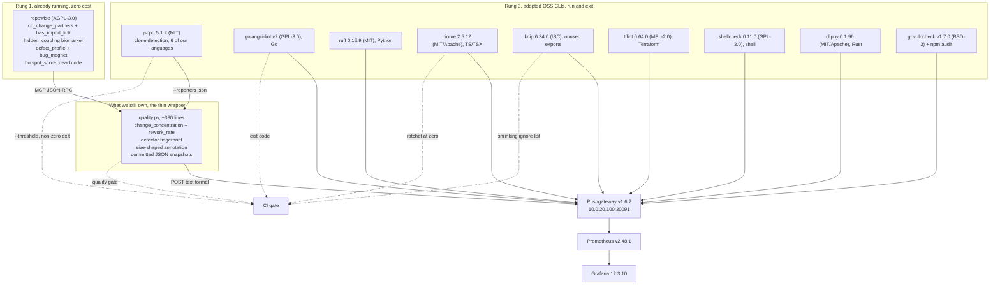

# OSS code quality tooling, adoption decision

Status: decision, ready for Viktor. Author: adoption pass 2026-09-06, over
`/home/wizard/code/terminal-lobby` and the 39 repos under `~/code`.
Supersedes the tooling half of
[`2026-09-06-code-quality-measurement.md`](2026-09-06-code-quality-measurement.md),
whose metric choices stand unchanged.

## The decision

Viktor asked whether we can reuse rather than build, and the answer is mostly
yes. **repowise**, which is already self-hosted here, computes the discovery
half and the import-link filter of our headline detector, and it found both
ground-truth defects at rank one without being told they existed. **jscpd**
(MIT, 5.1.2 published 2026-09-03) replaces our duplicate-file detector outright
and finds partial clones ours cannot see. Between them, three of our four
detectors are already computed by maintained software. What survives is
`rework_rate`, which nothing in a 27-tool survey computes, and the machinery
around the numbers: committed snapshots, a detector fingerprint that refuses a
dishonest diff, the size-shaped annotation, and the only Prometheus path any
candidate offers. So `docs/agents/code-quality` becomes a **thin wrapper**, and
about 250 of its 632 lines get deleted. Alongside that we adopt nine per-language
linters that answer a different question and cost nothing, since seven of them
are already on this box. New money: zero. New long-lived services: none.

## What we adopt

Sorted by how much of our own code each one removes.

| tool | licence, last release | what it gives | our languages | install cost | what it replaces |
|---|---|---|---|---|---|
| repowise (self-hosted MCP) | AGPL-3.0, running here, index age 0 days | `co_change_partners` each carrying `has_import_link`, a `hidden_coupling` biomarker, `defect_profile` with `bug_magnet` and per-symbol attribution, `hotspot_score`, dead code, cross-repo consumers | Go, TS/TSX, Python, Rust, Terraform indexed; shell indexed but not perf-analysed; Svelte unverified | zero, already deployed and indexed | `invisible_coupling` discovery and its import filter, `bug_magnets` outright |
| jscpd | MIT, 5.1.2 published 2026-09-03 | token-level clone detection across ~150 formats, JSON and SARIF reporters, `--threshold` exit code | Go, TS, TSX, JS, Python, shell all measured on this tree; Rust and Svelte supported upstream but absent here; no Terraform, no Vimscript | `npx jscpd@5.1.2`, nothing to install | `identical_file_pairs` outright, and better |
| golangci-lint | GPL-3.0 binary, adopt the v2 line (v1 discontinued 2025-03-24) | ~100 Go analyzers behind one config: errcheck, govet, staticcheck, gosec, unused, unparam, gocyclo | Go, all 14 terminal-lobby modules | one static binary, plus a persisted cache and an explicit `--timeout` | nothing of ours |
| ruff | MIT, 0.15.9, released roughly weekly | flake8, isort, pyupgrade, bandit's Python subset and more in one binary, with `--statistics` as a ready-made metric table | Python | already at `~/.local/bin/ruff` | nothing of ours |
| biome | MIT OR Apache-2.0, 2.5.12 pinned in `frontend-v2/package.json` | linter and formatter for JS/TS/JSX/TSX/JSON, currently at zero violations so it works as a ratchet | TS, TSX, JS, JSON. No Svelte template parser | already a devDependency | nothing of ours |
| knip | ISC, 6.34.0 published 2026-08-31 (repo pins the v5 schema) | unused files, exports, dependencies and unlisted binaries, with a shrinking ignore ratchet | TS, TSX, JS | already configured in `frontend-v2/knip.jsonc`, needs `npm install` | nothing of ours |
| tflint | MPL-2.0, 0.64.0 with ruleset.terraform 0.15.0 | unused declarations, missing version pins, untyped variables | Terraform | one Go binary | nothing of ours |
| govulncheck | BSD-3-Clause, v1.7.0 | symbol-level reachability against the Go vulnerability database, so a finding is a call you actually make | Go | `go install`, about 30s | nothing of ours, fills a gap the research doc named |
| shellcheck | GPL-3.0, 0.11.0 released 2025-08-03 (this box has 0.9.0 from 2022) | sh/bash correctness with stable SCxxxx codes | shell | one apt or one binary drop | nothing of ours |
| clippy | MIT OR Apache-2.0, 0.1.96 dated 2026-06-26 | ~750 Rust lints split by category, so correctness and perf trend separately | Rust | ships with the installed toolchain | nothing of ours |
| npm audit | Artistic-2.0, ships with node v24.15.0 | advisory counts by severity from the existing lockfile | TS, JS | zero | nothing of ours |
| Prometheus Pushgateway | Apache-2.0, v1.6.2, live in ns monitoring for 251 days | the push target our snapshots already use, alongside ~40 other homelab jobs | transport, language agnostic | zero | nothing, it is the export path that survives |

Where each sits on the reuse ladder: repowise is rung one, already running here.
jscpd, golangci-lint, ruff, biome, knip, tflint, govulncheck, shellcheck, clippy
and npm audit are rung three, adopted OSS. Nothing lands on rung four.

## What happens to the code we wrote

The verdict is **thin wrapper**. Here is the honest accounting, detector by
detector.

| our detector | fate | replaced by | evidence |
|---|---|---|---|
| `invisible_coupling` | discovery and filtering deleted, ranking kept | repowise | I called `get_risk` on the two ground-truth files in this session. `frontend-v2/public/sw.js` returned `frontend/sw.js` as co-change partner rank 1, count 8.64, `has_import_link: false`. `frontend-v2/src/telemetry/track.ts` returned `telemetry/events.go` at rank 1, count 8.13, `has_import_link: false`, with `hidden_coupling` listed as a critical biomarker at impact 0.99. `has_import_link` is our filter, already computed and stored |
| `identical_file_pairs` | deleted | jscpd | ours fires only when a byte-identical pair also co-changes. jscpd found the sw.js clone at rank 1 in 2.2s with no history requirement, and also found a 57-line `sudoers_test.go` clone and a 159-line markdown fragment that ours cannot see. I confirmed the pair by hand: md5 `45fb86f8295af12ea0d6d76d78e43a4b` for both files, 496 lines each |
| `bug_magnets` | deleted | repowise | its `defect_profile` uses the same 6-month window and adds per-symbol attribution plus a ranked `global_hotspots`. On `sw.js` it returned `fix_count: 5, bug_magnet: true, last_fix_days_ago: 4`, which is our detector's output with more detail attached |
| `change_concentration` | kept, ~15 lines | nothing | repowise gives a per-file `hotspot_score` and a top-5 ranking, not the share of touches landing in the top 10 files. code-maat's `revisions` gives the raw counts and the percentage is still our arithmetic |
| `rework_rate` | kept, ~40 lines | nothing | no tool in the survey has a revert or quick-fix notion. code-maat's 18 analyses contain none. This is the one detector with no OSS equivalent anywhere |

The machinery is where the honest answer diverges from "delete it all", and it
is worth being specific about which parts.

- **The detector fingerprint contract.** `detectors.json` is hashed into every
  snapshot and `diff` refuses to compare across a fingerprint change. Both
  committed snapshots carry `b46d4d88d7d8`. Nothing in the survey does this.
  code-maat prints CSV to stdout and forgets; repowise keeps a trend block
  inside its own service with no artifact in the repo.
- **The size-shaped annotation.** `SIZE_SHAPED` plus the same-direction test in
  `diff_series` is the piece that answers the problem that started this work,
  where line count called a good refactor a regression. No candidate reports a
  metric's move against a control series. This is roughly 20 lines and it is the
  most valuable 20 lines in the file.
- **The banned-metrics block, enforced by `test_quality.py`.** A policy artifact
  with no tool equivalent, and directly relevant given how many candidates lead
  with a rejected number.
- **The Pushgateway POST, 15 lines.** repowise answers over JSON-RPC on an MCP
  endpoint with no `/metrics` and no CLI on this box. jscpd, ruff, golangci-lint
  and the rest print JSON and push nothing. This is the only export path in the
  whole survey that reaches the Prometheus we already run.
- **The committed history snapshots.** Two exist. They stay readable, see
  Migration step 5.

So `quality.py` goes from 632 lines to roughly 380, of which about 200 is CLI
and machinery. It stops computing coupling, identity and defect history and
starts reading them from repowise and jscpd. Deleting it entirely would throw
away `rework_rate` and the only metrics export any of this has. Keeping it as is
would mean re-deriving what a running service already stores. Neither is right.

## The adopted pipeline

repowise covers the two dark-red boxes of the old design on its own. Everything
in rung 3 is a process that starts, prints JSON and exits. Nothing new is
deployed into the cluster.

## Ruled out, and why

Killed on licence, with the clause named so nobody re-proposes them.

| tool | the clause |
|---|---|
| CodeScene | "Free for your open-source project" scopes the free tier to public repos; "Unlimited private repositories" sits inside a paid plan at EUR 18 billed yearly, and on-prem is a paid deployment. Every repo here is private, so there is no free path. The page also pushes a converting trial, which the zero-cost rule bars outright |
| SonarQube Community Build | Analyzers moved to SSALv1 on 2024-11-29. The Non-competitive Purpose grant excludes any purpose "employing, using, or engaging artificial intelligence technology that is not part of the Program to ingest, interpret, analyze, train on, or interact with the data provided by the Program". Every workflow here is agent-driven, so piping its API output into Claude falls outside the grant. It is also source-available rather than open source. Separately it reads the working tree and no VCS history, so it replaces none of our four |
| Sourcegraph, and Code Insights | The OSS repo was archived 2024-09-30. Free and Pro tiers terminated; Code Insights is Enterprise-only at about USD 59 per user per month |
| Trunk Check and trunk.io | trunk-check itself is closed source. Free plan caps at 5 committers, self-hosted deployment is Enterprise and in private preview, and the CLI fetches tool payloads from trunk.io, so it fails the offline constraint too. The MIT `trunk-io/plugins` repo carries configs, not the checker |
| Simian | Proprietary. Free for open-source and non-commercial use only, paid per seat otherwise |
| Coverity Scan free tier | Open-source projects only, and the model uploads your build to the vendor, which breaks offline capability at the root |
| Codacy self-hosted | Commercial, self-hosted is a sales conversation. Nobody checked the current page this session, so treat this one as recalled rather than verified |
| Qodana | Free Community linters cover Python and nothing else of ours. Go, TypeScript and Rust need a paid Ultimate licence |
| Better Code Hub | Retired. No self-hostable artifact was ever published; its successor is commercial SaaS |

Ruled out on fit, not licence. **code-maat** (GPL-3.0, v1.0.4 released
2023-02-20) deserves its own paragraph because the brief asked for it directly.
It is genuinely free, and I take the licence correction seriously: the brief said
Apache-2.0 and the jar's own `project.clj` says GNU General Public License v3.0.
It was run here twice by different agents and it found both ground truths, the
sw.js pair at degree 80 and the telemetry pair at 54, in about 5 seconds. It
still loses. Its coupling analysis is raw co-change with no import-link check,
no byte-identity check, no test-partner exclusion and no language awareness, so
`frontend-v2/README.md` ranks first in its `soc` output at 626 and appears in
five of the top coupling rows. That is the input to our detector rather than the
detector. Adopting it would mean owning a frozen 39 MB Clojure jar pinned to
Clojure 1.8 from 2016, whose last three commits are documentation edits, plus a
JVM, in order to replace about 40 lines of Python that repowise already replaces
better and for free. **MegaLinter** (AGPL-3.0, v10.1.0 released 2026-09-05) is
alive and genuinely useful, and it fails us twice: its metrics reporter emits
InfluxDB line protocol, which our Prometheus rejected with HTTP 400 on both
receivers when tested from inside the pod, and its descriptor set has no Svelte
and no Vimscript linter despite the catalogue claim, so it covers 6 of our 8.
**Super-Linter**, **hercules**, **gitinspector**, **git-of-theseus** and
**git-quick-stats** all replace none of our four and several are dead.

## What it costs to run

| item | measured where | cost |
|---|---|---|
| money | n/a | zero. Everything adopted is free for private repos |
| repowise | already deployed | zero. `get_risk` on 3 files returned in about 1s in this session, index age 0 days at commit `0949fecc1f1f` |
| jscpd | survey run, twice | 2.2s to 2.6s over the full 194k-line tree at 5.1.2. `npx`, no install, no network after the fetch |
| ruff | survey run | 0.96s over all 39 repos. Already installed |
| biome | survey run | 2s over 416 files. Already a devDependency |
| knip | survey run | 59s once `node_modules` is complete. It is currently incomplete, which produces three false "unlisted binaries" |
| shellcheck | survey run | sub-second over 15 files |
| tflint | survey run | inside a 120s window over the whole infra tree, 730 findings |
| golangci-lint | survey run, and the adversary's correction | roughly 3 minutes cold across 14 modules. The default `--timeout=1m` was exceeded on a single small module, and a timed-out module reports zero findings, which is indistinguishable from clean. Set an explicit timeout and persist the cache, or the series lies |
| clippy | survey run | over 220s cold on the agent-conductor workspace, near-instant warm. Needs a cargo target cache in CI |
| govulncheck | survey run | about 15s per module, so about 2 minutes for terminal-lobby's 14. Needs network unless the DB is mirrored |
| our wrapper | measured before | about 20s per repo today, and less once coupling and defect work moves to repowise |

Long-lived services to operate: none. No JVM, no database, no Elasticsearch, no
second metrics store. The one operational dependency that is new in kind is
repowise's index freshness, and it already runs on its own schedule.

## Migration

1. Pin the versions in a committed config before anything else. jscpd 5.1.2 not
   4.0.5, golangci-lint v2 not 1.64.8, shellcheck 0.11.0 not 0.9.0, ruff 0.15.9
   with an explicit select list. Astral moves rules between preview and stable
   across minor releases, and shellcheck 0.11.0 disabled SC2002 by default, which
   alone would drop our shell count from 36 to 16 without a line changing.
2. Wire jscpd into `quality.py` as the `duplication` detector that
   `detectors.json` already declares and reports absent. Parse
   `statistics.total.percentage` plus the cross-file clone count. Gate on the
   cross-file count and the maximum clone length, not the dilutable percentage.
3. Replace `measure_coupling` and `measure_bug_magnets` with a repowise reader.
   Keep the ranking, the cross-language flag and the gate thresholds, since those
   are ours. Delete `references_each_other`, `files_identical`, `test_partner`,
   `same_go_package`, `coupling_degree` and `language`, roughly 250 lines.
4. Before deleting anything, run both implementations over terminal-lobby and
   `~/code/infra` and compare rankings. repowise found both ground truths at
   rank 1 in my test, and a like-for-like on a second repo is what turns that
   into a safe deletion.
5. Keep the committed snapshots readable. Bump `detectors.json` to version 2 when
   the detectors change, which changes the fingerprint and makes `diff` refuse to
   compare across the migration, exactly as designed. Leave
   `terminal-lobby-2026-09-06T050000.json` and `-T060000.json` in place with their
   `b46d4d88d7d8` fingerprint, and add a one-line note in the README saying which
   fingerprint belongs to which implementation.
6. Fix the own-test false positive while the code is open. `stem()` strips
   `_test.go` and `test_` but never normalises `-` to `_`, so
   `scripts/qa-harness.py` and `scripts/test_qa_harness.py` do not match and the
   pair survives to rank 3 in the last snapshot.
7. Add the per-language linters to CI behind `reviewdog -filter-mode=added`
   (MIT, v0.21.0 published 2025-09-03) so a new linter surfaces findings only on
   lines the current change touches. Without that, 202 golangci-lint findings and
   730 tflint findings arrive as one unreviewable wall.
8. Run `npm install` in `frontend-v2`. knip and biome are both pinned in
   `package.json` and neither is present in `node_modules`, so `npm run
   lint:exports` cannot run and knip's current output contains three false
   positives caused by that alone.

## Open questions

1. **Is a thin wrapper acceptable, or do you want it gone entirely?** Deleting
   the whole directory costs us `rework_rate`, the fingerprint contract, the
   size-shaped annotation and the only Prometheus export in the survey. My
   recommendation is the wrapper. Say the word and I will delete it instead and
   accept losing those.
2. **Does repowise's MCP-only interface bother you?** It has no `/metrics`, no
   CLI on this box, and a cron job has to speak JSON-RPC to reach it. A small
   exporter would fix that and it is new code, which is the thing this exercise
   exists to avoid. The alternative is keeping our git parsing for the coupling
   half, which is worse.
3. **Do the per-language linters gate CI or only trend?** Twelve series across
   eight languages at zero violations is a ratchet; the same twelve with a
   backlog is noise. biome and clippy are at zero today and can gate now.
   golangci-lint at 202 and tflint at 730 cannot.
4. **Three tools worth a trial that nobody ran properly.** Semgrep OSS
   (LGPL-2.1, v1.176.0 published 2026-09-01) is the only candidate whose rules
   can express the cross-language telemetry contract as a check rather than a
   correlation. PyDriller (Apache-2.0, pushed 2026-09-04) would replace our git
   plumbing with a maintained mining library. vulture (MIT) finds unused
   module-level functions that ruff's F401 structurally cannot. Worth an hour
   each, or worth dropping.
5. **The one finding this whole survey produced that is not about tooling.**
   This box runs go1.22.2, from April 2024, and govulncheck reports reachable
   standard-library vulnerabilities in every terminal-lobby module because of it.
   That is a toolchain upgrade, not a code quality metric, and no scanner here
   would have raised it before a CVE landed.
