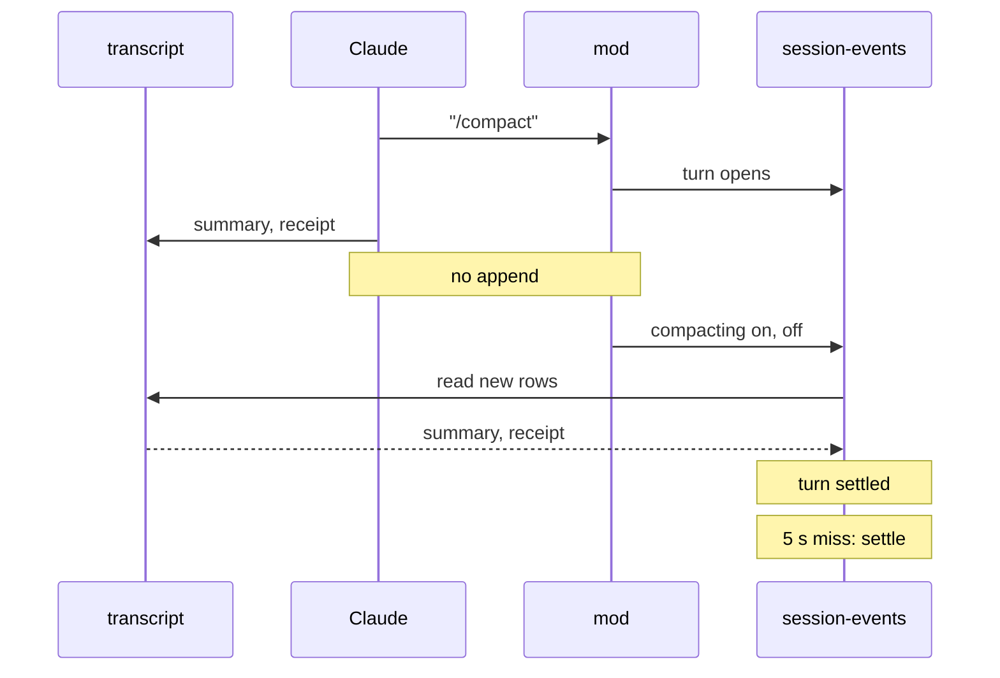

# /compact settles in the Text view on the mod path

## Problem

In the Text view, a `/compact` keeps its Working row after the compaction has
finished. A session-events restart clears it, because the rebuild replays the
transcript file.

Since ADR-0036, session-events learns about a Claude session through the
lobby's mod, and falls back to the transcript file only to rebuild a log. The
two inputs are meant to produce the same events. For a compaction they differ.

## What we measured

A throwaway logging mod on Claude Code 2.1.296 (2026-10-11) recorded every
`session.append` and `session.compact` during a manual `/compact`:

```
07:25:54.483 append door=prompt type=user "/compact"
07:25:54.511 compact start
07:25:56.227 compact end
```

The transcript gained six rows in the same window: the compact boundary, the
summary (`isCompactSummary`), the caveat, the command record, the command
receipt (`<local-command-stdout>`) and attachments. None of them raised
`session.append`. The mod reference says `session.append` covers "a
compaction's boundary and summary", so this looks like an engine gap rather
than intended behaviour; it is reported upstream.

The receipt is what settles the turn the `/compact` row opened, so on the mod
path that turn never closed. The mod does report the compaction, as a `level`
event whose `compacting` flag goes true and then false about 2 s later.

Other local commands, measured the same way:

| command | rows the engine sends the mod | turn left open? |
|---|---|---|
| `/compact` | the `/compact` row only | yes, on the mod path |
| compaction inside a turn | none of the compaction's rows (inferred, same code path) | no, the turn's own end closes it, but the marker is missing |
| `/model` | command record and receipt, both as `system/local_command` | no, but session-events dropped both |
| `/clear` | caveat, command record (user rows), empty receipt as a system row | yes, on both paths |

## Decisions

- Scope is every local slash command plus a compaction Claude starts itself.
- The live Text view matches what a transcript replay shows: Compacting while
  it runs, then the compaction marker and the receipt, and the turn settled.
- The fix lives in session-events, so running sessions get it with the next
  release. Mod changes only reach a session after its Claude restarts.
- On the compaction edge, session-events reads the missing rows from the
  transcript. This is the one live transcript read on the mod path.
- If the rows do not reach the file within 5 s, the `/compact` turn is settled
  anyway with no marker, and session-events logs a `compaction catch-up` line.
- A table-driven parity test holds each command's real input on both paths and
  checks the events match.



## Changes

| piece | change | where |
|---|---|---|
| compaction catch-up | `CompactionEnded` spots the true-to-false edge; `CatchUpCompaction` reads the transcript from the newest main-thread user or assistant row in the log, takes user and system rows up to the receipt (manual) or the summary (inside a turn), skips rows already in the log by uuid, and settles a `/compact` turn left open | `sessionio/compactcatchup.go`, `session-events/mod.go` |
| system rows on the mod path | `feedRow` maps the mod's `name` to the record's subtype and its text blocks to the record's content | `sessionio/modsource.go` |
| receipts as system rows | a `<local-command-stdout>` in a `system/local_command` row draws and settles like a user-row receipt, on both paths | `sessionio/normalize.go` |
| parity guard | each command's transcript lines and mod events produce the same events, and no turn stays open | `sessionio/commandparity_test.go` |
| docs | ADR-0036 amended; Compaction marker and Command receipt added to the glossary | `docs/adr/0036-…`, `CONTEXT.md` |

The catch-up shares the three replay slots with transcript rebuilds, so it
cannot add to a restart's load.

## Verification

After the release reaches the box, a scratch session runs `/compact`, `/model`
and `/clear` in the lobby's Text view. Each has to end with no Working row,
and `/compact` has to show the compaction marker and the receipt.

## Open questions

- If a later Claude does raise `session.append` for a compaction's rows, the
  catch-up skips them as already seen, but the summary would draw as a prompt,
  because a mod row carries no `isCompactSummary` flag. A live `/compact` after
  each Claude upgrade is the check until the engine's behaviour settles.
- The compaction-inside-a-turn row is inferred from the code path and from
  transcripts, not observed live through the mod.
