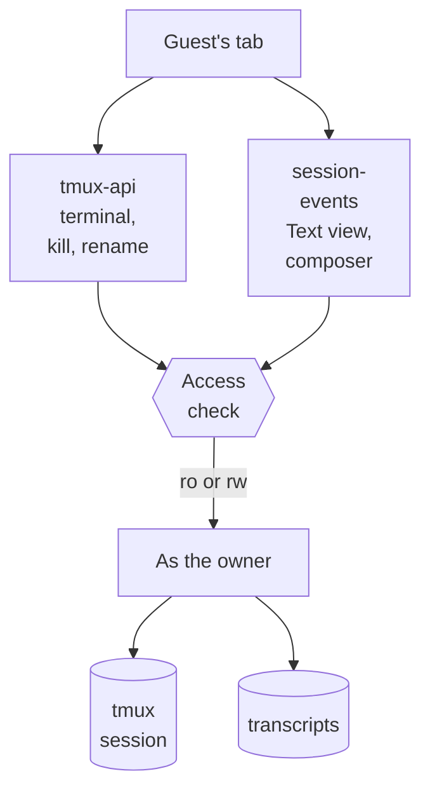

# Shared driving: two accounts in one session, both typing

**Status:** designed 2026-10-11, not started · **Scope:** `tmux-api/shares.go`,
`authuser/`, `session-events/` (Text view reads, `/prompt`, presence),
`devvm/tmux.conf.system`, `frontend-v2` (Share dialog, sidebar, session bar,
composer, Text view) · **ADR:**
[0043](../adr/0043-a-guest-drives-through-the-same-gate-as-the-terminal.md)

Viktor, 2026-10-11: *"i want 2 users to be able to share a session live. the
goal is to enable both users to be able to type and view the session live. we
may already have this."*

## What exists today

Named **Shares** have been on the server since the July multi-user work
(`docs/plans/2026-07-17-shared-multiuser-projects-and-sessions.md`). A guest
with a read-write share sees the session under "Shared with me" in the sidebar
and can attach its terminal, which runs `sudo -u <owner> tmux attach` after
`/internal/attach` finds the share row. The terminal half of the feature works.

What the lobby does not do yet for a guest:

| Piece | Today | Where |
|---|---|---|
| Invite someone | No screen; `POST /shares` only | `frontend-v2` never calls `/shares` |
| Text view | Reads the guest's own session of that name, or nothing | `session-events/main.go:138-142` |
| Composer send | Runs as the caller, never checks a share | `session-events/turn_routes.go:139-161` |
| Who else is here | Not shown; `list-clients` feeds only the Grid and push gating | `tmux-api/driven.go` |
| Who sent a prompt | Not recorded | no sender field in `sessionio/model.go` |
| Project member attach | Likely 403 "not shared"; the check reads only the share store (from reading the code, not tested) | `tmux-api/shares.go:462-484` |
| Watch guest | Can press `prefix (` or `)` and move to the owner's other sessions | tmux default bindings |

The watch-guest gap was reproduced on tmux 3.4 on 2026-10-11: a client
attached with `-r` pressed `C-b )` and moved from session `a` to `b`.

## Decisions

| # | Question | Decision |
|---|---|---|
| 1 | Who the second person is | Another lobby account on the box, through a named Share. Not a public link; links stay read-only (ADR-0041). |
| 2 | What a driving guest gets | What the owner gets: terminal, Text view, composer, question cards. |
| 3 | As whom it runs | The owner's uid, files, credentials and spend, as rw Shares do today. The invite is a trust decision. |
| 4 | How many guests | Any number per session. |
| 5 | Where the owner invites | One Share… dialog: People (account picker, Watch or Drive, default Drive) above Public link. |
| 6 | Lifetime | Until the session ends (the share is pinned to `session_id` + `session_created`). The owner or guest can remove it earlier; removal detaches the guest's live clients and stops their Text view and composer at the next request. |
| 7 | How the guest finds it | "Shared with me" in the sidebar (exists), one push on invite, and a lobby URL naming owner and session that opens only for an account with access. The URL grants nothing on its own. |
| 8 | Guest powers | Everything except sharing the session onward: type, answer questions, rename, kill. A guest kill names the owner in its confirm ("Kill viktor's session?") and pushes the owner. ADR-0025's undo window applies. |
| 9 | Pushes | The guest gets the invite push only. Turn-done and question pushes stay with the owner. |
| 10 | Access check | One function decides "may account G reach owner O's session S, and at what mode": a share row, or project membership at the project's attach mode, or admin act-as. Terminal attach, Text view reads and composer sends all call it. This also fixes the project-member 403. |
| 11 | Watch guests and switch-client | Close the gap in `devvm/tmux.conf.system` (see "Closing the watch gap"). |
| 12 | Presence | Everyone with the session open in a lobby tab, terminal or Text view, by heartbeat. The session bar names them ("viktor, emo present"); the owner's other devices count. |
| 13 | Attribution | Composer sends record the sender. The Text view labels user messages with it once a session has had a guest. Prompts typed into the terminal stay unlabelled, since tmux receives every keystroke as the owner. |
| 14 | Typing indicator | "emo is typing…" above the composer while another person drafts. Drafts stay private. Two sends at once queue in order (ADR-0042). |
| 15 | Window size | Whoever typed last, which is tmux's `latest` and what rw clients do today. |
| 16 | Audit | The sender is recorded in telemetry on each composer send, so `homelab claude-usage` shows who prompted a shared session. Spend stays the owner's. |
| 17 | Public links | Never show senders. Account names stay inside the box. |
| 18 | Phone | The dialog, presence line and typing line are built for the mobile layout and checked on the shared Android emulator. |

## How it fits together

### The access check

`handleInternalAttach` holds the logic today, for the terminal only. It moves
into a function both services can reach (tmux-api answers it over loopback, as
it answers `/internal/attach` now), and gains the project-membership branch.
session-events calls it whenever a request names an owner other than the
caller:

- Text view reads take `?owner=O`, check the caller has at least ro, and read
  through the privileged child that admin `?as=` already uses
  (`session-events/authuser.go`). No new sudo grant.
- `/prompt` takes `?owner=O` and requires rw. The send runs as the owner, and
  the sender (the caller) is stored next to the prompt.
- Kill and rename on tmux-api require rw and refuse a guest's request to share
  onward.

### Closing the watch gap

tmux lets a read-only client run only key bindings whose command is
`switch-client` or `detach-client`. Wrapping the default `switch-client`
bindings in `if-shell` keeps them working for read-write clients and makes them
do nothing for read-only ones. Tested on tmux 3.4 on 2026-10-11:

| Config | Client | After `C-b )` |
|---|---|---|
| tmux default | `-r` | moved to `b` |
| wrapped | `-r` | stayed on `a` |
| wrapped | read-write | moved to `b` |

The bindings to wrap are `prefix (`, `prefix )` and `prefix L`. The status-line
right-click menu uses `display-menu`, which a read-only client cannot run. The
file's existing invariant (never bind `switch-client -r`) stays.

`/etc/tmux.conf` loads before each user's `~/.tmux.conf` and only at server
start, so two cases need handling: a user config that rebinds these keys to a
bare `switch-client`, and tmux servers already running when the change lands.
The deploy can `source-file /etc/tmux.conf` into running servers; a user's own
rebind is their choice and is noted in `docs/multi-user.md`.

### Presence and typing

Each lobby tab with a session open sends a heartbeat to session-events every
few seconds, carrying the account, a device id, and whether the composer holds
an unsent draft that changed in the last few seconds. session-events keeps the
set in memory per (owner, session) and pushes it on the session's existing
event stream. The session bar draws the names; the composer draws the typing
line. A restart empties the set and the next heartbeats refill it.

### Attribution

The sender is known only at `/prompt`. session-events records `(session,
prompt text hash, sent-at, sender)`, and the Text view joins it to the user
message that appears in the transcript. A prompt typed into the terminal has no
record and shows no label. The label appears only on sessions that have had a
guest, so a session nobody shared looks as it does today.

## What we don't know yet

- How the sender record survives `/compact` and `/clear` rebuilds of the Text
  view. The join is by text and time, so it should, but this needs a test
  against a real compacted session.
- Whether the presence heartbeat should share the "N viewing" machinery from
  public links or stay separate. Both count readers in a 30-second window; the
  difference is that one is anonymous and this one has names.
- The project-member 403 is read from code. The first step of the work
  reproduces it before changing anything.
