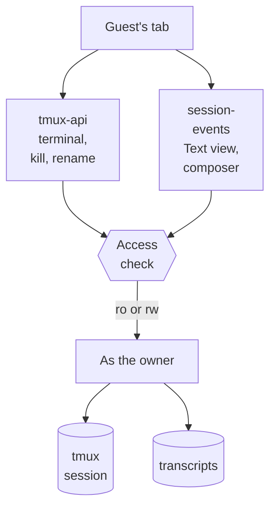
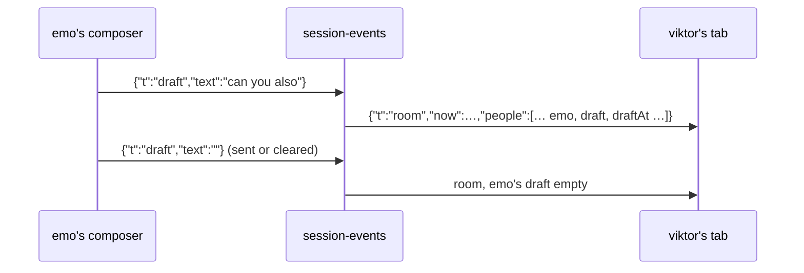

# Shared driving: two accounts in one session, both typing

**Status:** built 2026-10-11 · **Scope:** `tmux-api/access.go`,
`tmux-api/share_push.go`, `session-events/guest.go`, `session-events/presence.go`,
`sessionio/readonly_guard.go`, `devvm/tmux.conf.system`, `frontend-v2` (Share
dialog, session card, session bar, composer, Text view) · **ADR:**
[0043](../adr/0043-a-guest-drives-through-the-same-gate-as-the-terminal.md)

Viktor, 2026-10-11: *"i want 2 users to be able to share a session live. the
goal is to enable both users to be able to type and view the session live. we
may already have this."* Then, before the build: *"we need to have realtime
interactions between users so i should be able to see what other users type in
real time (or whether they are typing at all)"*, which changed decision 14 from
a typing indicator to a live draft preview.

## What exists today

Named **Shares** have been on the server since the July multi-user work
(`docs/plans/2026-07-17-shared-multiuser-projects-and-sessions.md`). A guest
with a read-write share sees the session under "Shared with me" in the sidebar
and can attach its terminal, which runs `sudo -u <owner> tmux attach` after
`/internal/attach` finds the share row. The terminal half of the feature works.

What the lobby does not do yet for a guest:

| Piece | Today | Where |
|---|---|---|
| Invite someone | No screen; `POST /shares` only | `frontend-v2` never calls `/shares` |
| Text view | Reads the guest's own session of that name, or nothing | `session-events/main.go:138-142` |
| Composer send | Runs as the caller, never checks a share | `session-events/turn_routes.go:139-161` |
| Who else is here | Not shown; `list-clients` feeds only the Grid and push gating | `tmux-api/driven.go` |
| Who sent a prompt | Not recorded | no sender field in `sessionio/model.go` |
| Project member attach | Likely 403 "not shared"; the check reads only the share store (from reading the code, not tested) | `tmux-api/shares.go:462-484` |
| Watch guest | Can press `prefix (` or `)` and move to the owner's other sessions | tmux default bindings |

The watch-guest gap was reproduced on tmux 3.4 on 2026-10-11: a client
attached with `-r` pressed `C-b )` and moved from session `a` to `b`.

## Decisions

| # | Question | Decision |
|---|---|---|
| 1 | Who the second person is | Another lobby account on the box, through a named Share. Not a public link; links stay read-only (ADR-0041). |
| 2 | What a driving guest gets | What the owner gets: terminal, Text view, composer, question cards. |
| 3 | As whom it runs | The owner's uid, files, credentials and spend, as rw Shares do today. The invite is a trust decision. |
| 4 | How many guests | Any number per session. |
| 5 | Where the owner invites | One Share… dialog: People (account picker, Watch or Drive, default Drive) above Public link. |
| 6 | Lifetime | Until the session ends (the share is pinned to `session_id` + `session_created`). The owner or guest can remove it earlier; removal detaches the guest's live clients and stops their Text view and composer at the next request. |
| 7 | How the guest finds it | "Shared with me" in the sidebar (exists), one push on invite, and a lobby URL naming owner and session that opens only for an account with access. The URL grants nothing on its own. |
| 8 | Guest powers | Everything except sharing the session onward: type, answer questions, rename, kill. A guest kill asks first, naming the owner ("Kill emo's session …? emo will be told it was you."), and pushes the owner. A guest can also leave a share. |
| 9 | Pushes | The guest gets the invite push only. Turn-done and question pushes stay with the owner. |
| 10 | Access check | One function decides "may account G reach owner O's session S, and at what mode": a share row, or project membership, or admin act-as. Terminal attach, Text view reads and composer sends all call it. This also fixes the project-member 403. Project membership only ever watches (decided after the security review, see below); driving needs a share the owner made. |
| 11 | Watch guests and switch-client | Close the gap in `devvm/tmux.conf.system` (see "Closing the watch gap"). |
| 12 | Presence | Everyone with the session open in a lobby tab, terminal or Text view, over a WebSocket per tab. The session bar names the others ("emo here", "bob (watching) here"); your own other devices are you, not company. |
| 13 | Attribution | Composer sends record the sender. The Text view labels user messages with it once a session has had a guest. Prompts typed into the terminal stay unlabelled, since tmux receives every keystroke as the owner. |
| 14 | Live drafts | Each person's unsent draft streams to the others as they type, read-only above the composer, with "emo is typing" while it moves and "emo has an unsent message" once it rests. A watcher has no composer and publishes nothing. Two sends at once queue in order (ADR-0042). |
| 15 | Window size | Whoever typed last, which is tmux's `latest` and what rw clients do today. |
| 16 | Audit | The sender is recorded in telemetry on each composer send, so `homelab claude-usage` shows who prompted a shared session. Spend stays the owner's. |
| 17 | Public links | Never show senders. Account names stay inside the box. |
| 18 | Phone | The dialog, presence line and typing line are built for the mobile layout and checked on the shared Android emulator. |
| 19 | Attachments from a guest | Refused, with a message saying why. The attachment store is per account, so a guest's upload lands under the guest, where the owner's Claude cannot read it. |

## How it fits together

### The access check

`handleInternalAttach` holds the logic today, for the terminal only. It moves
into a function both services can reach (tmux-api answers it over loopback, as
it answers `/internal/attach` now), and gains the project-membership branch.
session-events calls it whenever a request names an owner other than the
caller:

- Text view reads take `?owner=O`, check the caller has at least ro, and read
  through the privileged child that admin `?as=` already uses
  (`session-events/authuser.go`). No new sudo grant.
- `/prompt` takes `?owner=O` and requires rw. The send runs as the owner, and
  the sender (the caller) is stored next to the prompt.
- Kill and rename on tmux-api require rw and refuse a guest's request to share
  onward.

### Closing the watch gap

tmux lets a read-only client run only key bindings whose command is
`switch-client` or `detach-client`. Wrapping the default `switch-client`
bindings in `if-shell` keeps them working for read-write clients and makes them
do nothing for read-only ones. Tested on tmux 3.4 on 2026-10-11:

| Config | Client | After `C-b )` |
|---|---|---|
| tmux default | `-r` | moved to `b` |
| wrapped | `-r` | stayed on `a` |
| wrapped | read-write | moved to `b` |

tmux runs a binding for a read-only client only when every command in it is
one tmux allows such a client, and `switch-client` and `detach-client` are two
of them. `/etc/tmux.conf` wraps the three defaults (`prefix (`, `prefix )`,
`prefix L`). On each guest's watch attach, tmux-api wraps every binding in the
owner's running server, in every key table, that runs `switch-client`, or
`detach-client` with a flag (`-a` would detach the owner's own clients), and
loads them back through `source-file -` so tmux's own escaping round-trips.
Plain `detach-client` only leaves and is not wrapped. The security review found
oh-my-tmux's `prefix BTab` (`switch-client -l`) in this box's own config, which
the first version, three keys by name, missed. The status-line right-click
menu uses `display-menu`, which a read-only client cannot run. The file's
existing invariant (never bind `switch-client -r`) stays.

`/etc/tmux.conf` loads before each user's `~/.tmux.conf` and only at server
start, so the wrapping on each watch attach is what covers servers already
running and bindings an account's own config adds. The attach is refused if it
cannot be applied.

### Presence and live drafts

Each lobby tab with a session on screen holds one WebSocket to
`GET /events/{session}/presence` on session-events, a guest naming the owner
with `?owner=` like every other route. The ingress already routes `/events/`
there. session-events keeps the people in memory per (owner, session) and sends
every socket the whole room whenever it changes: someone arriving, leaving, or
changing their draft. A room is a few people, so the whole room is a few
hundred bytes and the client merges nothing.

The composer sends its draft at most every 80 ms, always the newest text, and
an empty draft at once. A draft is capped at 2,000 characters. Whether a person
is typing or has stopped is decided on the client from the draft's `draftAt`
against the frame's `now`, both on the server's clock, so a device's own clock
never enters it. A restart of session-events empties the rooms; each tab
reconnects and republishes its draft.

### Attribution

The sender is known only at `/prompt`. session-events records each accepted
prompt as `(text, at, user, name)`, up to 500 per session, in a file per
session beside the held prompts so it survives a restart. The file is named by
tmux's session id and creation time, not the session's name: a rename keeps
the records, and a later session that takes the name starts with none, so a
guest invited to it never sees an earlier session's prompts. The presence socket
sends the records on connect and each new one as it happens. The Text view
matches records to user messages by their words, oldest first, each record
labelling one message sent no more than two hours earlier. A prompt typed into
the terminal has no record and shows no label. Labels appear only once someone
other than the owner has sent, so a session nobody shared looks as it does
today.

## Security review, 2026-10-11

A review of the branch before it landed found these, all fixed before release:

| Finding | Fix |
|---|---|
| Any project member may set a project's attach mode, so project rw let one member drive another's session as them | Project membership only ever watches; driving needs a share (Viktor's choice) |
| The read-only guard covered three keys by name; this box's oh-my-tmux binds `prefix BTab` to `switch-client -l` | Every switching binding in every table is wrapped |
| Sender records keyed by session name reached the next session of that name | Keyed by tmux session id and creation time |
| An escaped `/` in a path made the access check and the handler see different names | A guest request with an escaped path is refused |
| A rename onto a name a dead session's share row still held failed the share rewrite | The dead row is dropped first |
| A guest's attachments landed in the guest's own store | Refused for guests, with a message |

## What we don't know yet

- How sender labels behave across `/compact` and `/clear` rebuilds of the Text
  view. The join is by words and time, so it should hold, but it has not been
  tried on a real compacted session.
- Labels are matched over the turns the Text view has loaded. With the same
  words sent several times and older turns not loaded yet, a label can land on
  the wrong copy until the earlier turns load.
- The project-member 403 was found by reading the code and is now covered by a
  test of the attach handler (`TestInternalAttachProjectMember`); it has not
  been reproduced against the deployed box.
