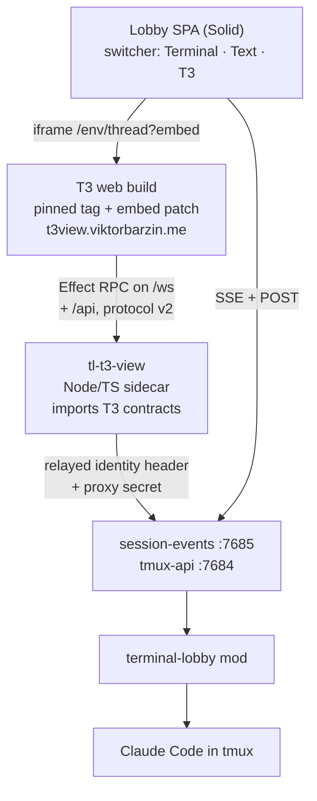

# T3 view: T3 Code's chat UI as a third view of a lobby session

**Status:** designed 2026-10-12, not built · **Scope:** new `t3-view/` (Node/TS
sidecar `tl-t3-view` plus the pinned T3 web build), `frontend-v2` (view switcher,
iframe host), `release/` (manifest, deb), `infra/stacks/terminal` (hostname),
`infra/playbooks/devvm.yml` (firewall) · **ADR:**
[0044](../adr/0044-t3-code-renders-a-session-through-its-own-protocol.md)

Viktor, 2026-10-12: *"I'm keen on reusing t3 code into my terminal lobby,
especially the text mode. Theo is putting a lot of work into making t3 code and
I'd like to build on top instead of reinventing the wheel."* Then, after the
design was agreed: *"we need to have both text mode options live so I can
compare"*, which settled the switcher as Terminal · Text · T3.

## Where we start from

The lobby's Text view is about 19.4k lines of Solid and TypeScript. It follows
T3 Code's design closely: the folding rules in `timeline.logic.ts` cite T3's
`MessagesTimeline.logic.ts`, and the September T3 pass rebuilt the composer, the
model sheet and the work groups after T3's. None of it is T3 code. Each
improvement T3 ships is ported by hand, or not at all.

An earlier integration ran the other way. ADR-0009 made a lobby session
operable from inside T3 through a provider binary; ADR-0029 removed it in
September when T3 stopped being the surface Viktor used. This design keeps the
lobby as the surface and brings T3's UI into it.

What upstream looks like today (measured against `~/src/t3code`, fetched
2026-10-12):

| Fact | Evidence |
|---|---|
| Only the server bundle `t3` is published | every `@t3tools/*` package is `"private": true` |
| The web client is React 19, Tailwind, shadcn, TanStack Router | `apps/web` |
| The chat UI is wired into T3's own stores | `MessagesTimeline.tsx` imports about 70 modules; `ChatView.tsx` is 12.2k lines |
| It changes quickly | 153 commits to `MessagesTimeline.tsx` and 370 to `packages/contracts` in 60 days |
| Client and server talk Effect RPC over WebSocket, versioned | `ORCHESTRATION_PROTOCOL_VERSION`, exact match required |
| Protocol v2 landed on 2026-10-02 and is not yet in a stable | `v0.0.45` is v1; `v0.0.46-nightly.20261011.2994` is v2 |
| The hosted app.t3.codes is a pure client of any `t3 serve` | `docs/internals/remote.md` |
| License is MIT | `LICENSE` |

So T3's components cannot be imported into another app, but T3's whole web
client can be pointed at any server that speaks its protocol.

## The approach

Serve an unmodified T3 web build from a pinned tag, and have the lobby speak
T3's protocol. A small sidecar translates lobby sessions into T3 threads and
T3's commands into lobby requests. The Claude behind each thread is still the
interactive Claude Code in tmux that the terminal shows, fed through the mod
(ADR-0036).

Three other shapes were considered:

| Shape | Why not |
|---|---|
| Run real T3 with an ACP agent that attaches to tmux | A second server per user, and a thread-list sync like the one ADR-0029 removed (15.7k lines) |
| Fork `apps/web` and swap its data layer for lobby SSE | The patches would sit in the most-changed files in the repo |
| Copy T3's React-free presentation logic into Solid | Keeps the composer and mobile UX hand-ported, which is what this design sets out to stop |

## Decisions

| # | Question | Decision |
|---|---|---|
| 1 | What to take from T3 | Chat rendering, the composer and mobile UX, and upstream improvements over time |
| 2 | Session model | Unchanged: tmux-backed Claude through the mod. T3 renders and drives it; it never spawns a Claude |
| 3 | Upstream | Track upstream with a thin patch set |
| 4 | Approach | The lobby speaks T3's protocol; T3 web runs unmodified apart from the embed patch |
| 5 | Protocol version | v2. Pin a nightly until the first v2 stable, then follow stable releases |
| 6 | Bumps | Manual, when Viktor asks. A bump rebuilds the web, fixes compile breaks in the sidecar, re-applies the patch and runs the golden tests |
| 7 | Adapter | `tl-t3-view`, a Node/TS sidecar that imports `packages/contracts` from the pinned checkout and serves `WsRpcGroup` with Effect's `RpcServer`, so a contract change fails the build |
| 8 | Hostname | A new subdomain, `t3view.viktorbarzin.me`, because T3 needs the root of its origin (`/assets`, `/api`, `/ws`, its own routes) and the lobby already uses those paths. `t3.viktorbarzin.me` and `t3-dispatch` stay as they are and are retired separately |
| 9 | Patches | One: `?embed` hides T3's sidebar and header, and forwards Ctrl-J and Esc to the lobby through `postMessage` |
| 10 | Placement | T3 renders one thread in the session pane, in the Text view's slot. The lobby keeps its sidebar, tiles and session bar |
| 11 | Switcher | Terminal · Text · T3, remembered per session as `viewmode.ts` does today. Both text renderers stay live against the same session |
| 12 | Who sees T3 | Admins only, from `/whoami`'s `admin` flag. Today that is `wizard` alone (`/etc/ttyd-admins`) |
| 13 | Default view | The Solid Text view |
| 14 | Solid Text view while both exist | Bug fixes only; new text features go into the T3 path |
| 15 | Retiring the Solid view | Viktor's call, informed by the must-have list below and view-usage telemetry |
| 16 | Guests and public links | Stay on the Solid view until the retirement decision |
| 17 | Harnesses | Claude only. pi and codex keep the Solid view |
| 18 | Identity | The new ingress sits in the terminal stack with the same `authentik-forward-auth` and `tl-proxy-secret` middleware. The sidecar relays both headers on every call, so the lobby's access rules decide what it sees |
| 19 | Which sessions appear | What the lobby shows that user: Claude sessions only, grouped into lobby projects |
| 20 | Read-only sessions | Listed; a send is refused with the lobby's reason |
| 21 | New thread | Creates a lobby session in that project, through the same path as the lobby's New session |
| 22 | Steer, queue, restart | `steer_active` becomes a lobby steer (ADR-0042), `queue_after_active` a prompt the sidecar holds until the turn ends, `restart_active` Stop then send. The lobby has no "wait for the turn to end without steering" of its own: since ADR-0042 every mid-turn message steers |
| 23 | Permission modes | T3's own Claude table (below). A session in `dontAsk` shows as approval-required with a notice row, "No ask, set outside T3"; T3's picker cannot choose it |
| 24 | T3 panels | Terminal and git hidden through auth scopes; other panels stubbed. The model list comes from the lobby's existing list |
| 25 | Mobile | The web view inside the lobby only. T3's Expo app would need pairing tokens, which forward-auth blocks |
| 26 | First cut | Streaming text, thinking, tool rows, permission, plan and question cards, send, stop, model and mode |
| 27 | Second cut | Images (attachments and inline pictures) and history paging |

## How the sidecar maps a session to a thread

### What the web client needs

Traced statically in `v0.0.46-nightly.20261011.2994`:

| Kind | Endpoints |
|---|---|
| HTTP | `GET /.well-known/t3/environment` (must carry `orchestrationProtocolVersion: 2`), `GET /api/auth/session`, `GET /api/orchestration/shell`, `GET /api/orchestration/threads/:id/bounded`, `GET /api/orchestration/threads/:id/history?cursor=` |
| RPC, needed | `subscribeServerConfig`, `server.probe`, `subscribeServerLifecycle`, `orchestration.subscribeShell`, `orchestration.subscribeThread`, `orchestration.dispatchCommand`, `orchestration.launchThread` |
| RPC, later | `getTurnItem`, `searchThread(s)`, `subscribeArchivedShell`, `subscribeAuthAccess` |
| RPC, stubbed | the rest of about 193 |

`/api/auth/session` answers `authenticated: true` with the scopes the chat
needs, which skips T3's pairing flow. Leaving out `terminal:*` and the
source-control write scope hides the terminal drawer and git actions.

### Lobby to T3

| Lobby | T3 v2 |
|---|---|
| Project | `project` in the shell snapshot |
| Session (Claude) | thread; thread id = the session's minted name (ADR-0019) |
| `user` | `user_message` turn item |
| `text`, `delta` | `assistant_message`; each update re-sends the accumulated text, since v2 has no delta event |
| `thinking` | `reasoning` |
| `tool_use` + `tool_result` | Bash → `command_execution`; Edit, MultiEdit, Write, NotebookEdit → `file_change`; WebSearch, WebFetch → `web_search`; the rest → `dynamic_tool` (T3's own table, `ClaudeAdapterV2.ts:1805-1846`) |
| AskUserQuestion held by the mod | `user_input_request` + a `runtime-request` |
| Permission or plan dialog held by the mod | `approval_request` / `proposed_plan` + a `runtime-request` |
| `state` running / idle | run status |
| `meta` queued / dequeued | queued runs with `queuePosition` |
| `meta` permission-mode, model | `runtimeMode`, `interactionMode`, `modelSelection` |
| `turn_end` | run completed |

### T3 to lobby

| T3 command | Lobby request |
|---|---|
| `message.dispatch`, `start_immediately` | `POST /prompt/{s}` |
| `message.dispatch`, `steer_active` | `POST /prompt/{s}` mid-turn: session-events holds it and the mod attaches it at the next tool boundary (ADR-0042) |
| `message.dispatch`, `queue_after_active` | held by the sidecar until the run ends, then `POST /prompt/{s}` |
| `message.dispatch`, `restart_active` | `POST /cancel/{s}`, then `POST /prompt/{s}` |
| `queued-run.cancel`, `.edit` | a steer still held: `POST /prompt/{s}/cancel-queued` or `/unqueue`; a sidecar-held message: dropped or replaced in the sidecar |
| `run.interrupt` | `POST /cancel/{s}` |
| `runtime-request.respond` | `POST /answer/{s}` |
| `thread.runtime-mode.set`, `thread.interaction-mode.set` | `POST /model/{s}` (mode) |
| `thread.model-selection.set` | `POST /model/{s}` (model, effort) |
| `launchThread` | the lobby's new-session path in that project, then the first prompt |

### Permission modes

| T3 | Claude Code |
|---|---|
| `interactionMode: plan` | `plan` |
| `approval-required` | `default` |
| `auto-accept-edits` | `acceptEdits` |
| `auto` | `auto` |
| `full-access` | `bypassPermissions` |
| (none) | `dontAsk`, shown as decision 23 describes |

## Building and shipping

- `t3-view/T3_PIN` names the tag and commit. `t3-view/patches/embed.patch` is
  the one patch.
- GitHub Actions (`release.yml`) checks out T3 at the pin, applies the patch,
  builds `apps/web` with pnpm through corepack, and bundles the sidecar. Nothing
  builds on the devvm.
- The deb ships both the way it ships `tl-browser-host`: a tree under
  `/usr/lib/terminal-lobby/tl-t3-view`, a `devvm/tl-t3-view.service` unit as
  `wizard`, and a health check in `release/manifest.go`. Node 24 is already a
  Recommends of the package.
- Infra: a `t3view` ingress in `infra/stacks/terminal` (same middleware as the
  lobby's routes) with a Service and Endpoints to the sidecar's port on
  `10.0.10.10`, and a firewall rule in `infra/playbooks/devvm.yml` that accepts
  that port from the Traefik nodes only.

## Comparing the two views

The switcher records a `view.switched` event with `tl.to` set to `terminal`,
`text` or `t3`. Time per view comes from consecutive switches per device, since
the journey design's dwell events are not built. The event vocabulary is
closed, so the new value goes into `track.ts`, `telemetry/events.go` and
ADR-0006 together.

Must-haves the T3 view reaches before retiring the Solid view comes up:

| Must-have | First cut |
|---|---|
| Streaming replies, thinking, tool rows | yes |
| Permission, plan and question cards | yes |
| Send, Stop, model, effort, mode | yes |
| Queued messages and steering | yes |
| Phone layout inside the lobby | yes |
| Inline pictures and image attachments | second cut |
| Load earlier turns | second cut |
| Find in session | not planned yet |
| Subagent panel and steering a subagent | not planned yet |
| Guests and public links | not planned yet |
| Presence and live drafts | not planned yet |

## Testing

- The mapper is written test-first: lobby events in, T3 entities out.
- Golden tests reuse T3's testkit: 41 recorded Claude scenarios under
  `apps/server/src/orchestration-v2/testkit/fixtures/`. Each is fed through the
  sidecar and the result compared with the projection T3's own orchestrator
  produces from the same transcript. `simple`, `multi_turn`, `message_steering`,
  `queued_turn`, `plan_questions` and `proposed_plan` cover the first cut.
- Live checks drive the T3 view on the shared Android emulator and on
  `homelab ios`, against a scratch session.

## Order of work

1. Log the RPCs the real web app calls on boot and on opening a thread, by
   running the pinned server and web together. This replaces the static trace
   above.
2. Sidecar skeleton: environment descriptor, auth session, config and lifecycle
   snapshots, an empty shell. The web loads without the first-run wizard.
3. Shell from tmux-api `/sessions` and `/projects`; read-only thread rendering
   from session-events.
4. Commands: send, stop, answer, model and mode, steer and queue, new thread.
5. Embed patch, the iframe host and the switcher's third option behind the
   admin gate.
6. Packaging, the `t3view` ingress and the firewall rule; live checks on phone
   and desktop.
7. Second cut: images and history paging.

## Open questions

- The boot trace is static. Some of the stubbed RPCs may fire on load and need
  a real empty answer rather than an error; step 1 settles which.
- How Effect's `RpcServer` answers a method the sidecar does not register,
  compared with one it registers as a stub.
- Whether real file diffs need `getTurnDiff` (T3 reads them from git
  checkpoints) or whether the Edit tool's own input is enough for the work log.
- What a stable bump costs once v2 is stable. Between earlier stables the
  contracts diff ranged from 0 to about 1k lines; the v1-to-v2 change was
  +9.8k / −3.1k.
- Whether streaming full accumulated text on every update is light enough on a
  phone connection for long replies. T3's server flushes at markdown
  boundaries, and the sidecar can do the same.
