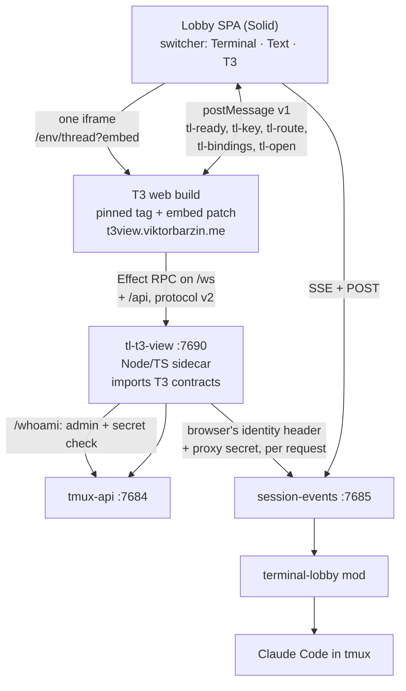

# T3 view: T3 Code's chat UI as a third view of a lobby session

**Status:** first cut released in terminal-lobby 0.125.2 (designed, built
and released 2026-10-12), model picker fixed in 0.125.3, frame preloaded on desktop in
0.126.0 (2026-10-13) · **Scope:** new `t3-view/` (Node/TS
sidecar `tl-t3-view` plus the pinned T3 web build and its embed patch),
`frontend-v2` (view switcher, iframe host), `session-events` (dialog ids, a
prompt that waits for the turn's end), `tmux-api` (a claim that places its
session), `release/` and `packaging/` (manifest, deb, CI), `infra/stacks/terminal`
(hostname, AdminNetworkPolicy), `infra/playbooks/devvm.yml` (firewall) ·
**ADR:** [0044](../adr/0044-t3-code-renders-a-session-through-its-own-protocol.md)

Viktor, 2026-10-12: *"I'm keen on reusing t3 code into my terminal lobby,
especially the text mode. Theo is putting a lot of work into making t3 code and
I'd like to build on top instead of reinventing the wheel."* Then, after the
design was agreed: *"we need to have both text mode options live so I can
compare"*, which settled the switcher as Terminal · Text · T3.

This document was written as a design and revised after the build. Two
challenger reviews changed parts of the design before any code was written,
and the build changed a few more; both are folded in below, and
[What changed during the build](#what-changed-during-the-build) lists them.

## Where we start from

The lobby's Text view is about 19.4k lines of Solid and TypeScript. It follows
T3 Code's design closely: the folding rules in `timeline.logic.ts` cite T3's
`MessagesTimeline.logic.ts`, and the September T3 pass rebuilt the composer, the
model sheet and the work groups after T3's. None of it is T3 code. Each
improvement T3 ships is ported by hand, or not at all.

An earlier integration ran the other way. ADR-0009 made a lobby session
operable from inside T3 through a provider binary; ADR-0029 removed it in
September when T3 stopped being the surface Viktor used. This design keeps the
lobby as the surface and brings T3's UI into it.

What upstream looks like (measured against `~/src/t3code`, fetched
2026-10-12):

| Fact | Evidence |
|---|---|
| Only the server bundle `t3` is published | every `@t3tools/*` package is `"private": true` |
| The web client is React 19, Tailwind, shadcn, TanStack Router | `apps/web` |
| The chat UI is wired into T3's own stores | `MessagesTimeline.tsx` imports about 70 modules; `ChatView.tsx` is 12.2k lines |
| It changes quickly | 153 commits to `MessagesTimeline.tsx` and 370 to `packages/contracts` in 60 days |
| Client and server talk Effect RPC over WebSocket, versioned | `ORCHESTRATION_PROTOCOL_VERSION`, exact match required |
| Protocol v2 landed on 2026-10-02 and is not yet in a stable | `v0.0.45` is v1; `v0.0.46-nightly.20261011.2994` is v2 |
| The hosted app.t3.codes is a pure client of any `t3 serve` | `docs/internals/remote.md` |
| License is MIT | `LICENSE` |

So T3's components cannot be imported into another app, but T3's whole web
client can be pointed at any server that speaks its protocol.

## The approach

Serve an unmodified T3 web build from a pinned tag, plus one embed patch, and
have the lobby speak T3's protocol. A sidecar translates lobby sessions into T3
threads and T3's commands into lobby requests. The Claude behind each thread is
still the interactive Claude Code in tmux that the terminal shows, fed through
the mod (ADR-0036).

Three other shapes were considered:

| Shape | Why not |
|---|---|
| Run real T3 with an ACP agent that attaches to tmux | A second server per user, and a thread-list sync like the one ADR-0029 removed (15.7k lines) |
| Fork `apps/web` and swap its data layer for lobby SSE | The patches would sit in the most-changed files in the repo |
| Copy T3's React-free presentation logic into Solid | Keeps the composer and mobile UX hand-ported, which is what this design sets out to stop |

## Decisions

| # | Question | Decision |
|---|---|---|
| 1 | What to take from T3 | Chat rendering, the composer and mobile UX, and upstream improvements over time |
| 2 | Session model | Unchanged: tmux-backed Claude through the mod. T3 renders and drives it; it never spawns a Claude |
| 3 | Upstream | Track upstream with a thin patch set |
| 4 | Approach | The lobby speaks T3's protocol; T3 web runs unmodified apart from the embed patch |
| 5 | Protocol version | v2. Pinned to `v0.0.46-nightly.20261011.2994` (commit `d07a07f3`) until the first v2 stable, then stable releases |
| 6 | Bumps | Manual, when Viktor asks. A bump rebuilds the web, fixes compile breaks in the sidecar, re-applies the patch and re-runs the tests over the recorded lobby captures |
| 7 | Adapter | `tl-t3-view`, a Node/TS sidecar that imports `packages/contracts` from the pinned checkout and serves `WsRpcGroup` with Effect's `RpcServer`, so a contract change fails the build |
| 8 | Hostname | `t3view.viktorbarzin.me`, because T3 needs the root of its origin (`/assets`, `/api`, `/ws`, its own routes) and the lobby already uses those paths. `t3.viktorbarzin.me` and `t3-dispatch` stay as they are and are retired separately |
| 9 | Patches | One, `patches/embed.patch`. Under `?embed`, inside a frame, it hides T3's sidebar, header, terminal toggle and git and preview controls, forwards the lobby's key bindings, reports route changes, and turns on T3's plan toggle. Contract: [`t3-view/EMBED.md`](../../t3-view/EMBED.md) |
| 10 | Placement | T3 renders one thread in the session pane, in the Text view's slot. The lobby keeps its sidebar, tiles and session bar |
| 11 | Switcher | Terminal · Text · T3, remembered per session as `viewmode.ts` does today. Both text renderers stay live against the same session |
| 12 | Who sees T3 | Admins only: the lobby offers it from `/whoami`'s `admin` flag, and the sidecar refuses any caller tmux-api does not call an admin. Today that is `wizard` alone (`/etc/ttyd-admins`) |
| 13 | Default view | The Solid Text view |
| 14 | Solid Text view while both exist | Bug fixes only; new text features go into the T3 path |
| 15 | Retiring the Solid view | Viktor's call, informed by the must-have list below and view-usage telemetry |
| 16 | Guests and public links | Stay on the Solid view until the retirement decision |
| 17 | Harnesses | Claude only. pi and codex keep the Solid view |
| 18 | Identity | The new ingress sits in the terminal stack with the same `authentik-forward-auth` and `tl-proxy-secret` middleware. The sidecar checks every request and WebSocket upgrade itself (below) and relays the browser's identity header and proxy secret on every lobby call, so the lobby's access rules decide what it sees |
| 19 | Which sessions appear | What the lobby shows that user: Claude sessions only, grouped into lobby projects |
| 20 | Read-only sessions | Listed; a send is refused with the lobby's reason |
| 21 | New thread | Creates a lobby session in that project: a pre-warm slot claimed with the project named, so tmux-api places it under its layout lock |
| 22 | Steer, queue, restart | `steer_active` becomes a lobby steer (ADR-0042); `queue_after_active` a prompt session-events holds until the turn ends (`POST /prompt {wait: true}`); `restart_active` Stop with the queue restored, then send |
| 23 | Permission modes | T3's own Claude table (below). A session in `dontAsk` shows as approval-required with a notice row, "No ask, set outside T3"; T3's picker cannot choose it |
| 24 | T3 panels | Terminal and source-control writes refused through auth scopes, and their controls hidden by the embed patch; other panels stubbed with empty answers. The model list mirrors the lobby's catalogue (`frontend-v2/src/lib/models.ts`) |
| 25 | Mobile | The web view inside the lobby only. T3's Expo app would need pairing tokens, which forward-auth blocks |
| 26 | First cut | Streaming text, thinking, tool rows, permission, plan and question cards, send, stop, model, effort and mode, steer and queue, new thread |
| 27 | Second cut | Images (attachments and inline pictures) and history paging |
| 28 | Thread id | A rename-proof key, not the session's minted name: `bornAs`, else for a hand-named session the name first seen plus tmux's `#{session_id}`; a session T3 created keeps T3's id; someone else's session is `<owner>~<key>`. The sidecar maps the id to the current name before every call and follows renames |
| 29 | Frames | At most one T3 iframe per tab, across keepalive and tiles. Another tile that wants T3 shows "The T3 view is open in another tile" until it holds the frame (`frontend-v2/src/t3/frame-claim.ts`) |

## How the sidecar maps a session to a thread

### What the web client asks for

Measured, not traced statically: the stage 1 run drove the real web client
against the real T3 server at the pin, on desktop and phone, and recorded
every request ([`t3-view/TRACE.md`](../../t3-view/TRACE.md), raw captures in
`t3-view/trace/`).

| Kind | What fired |
|---|---|
| HTTP | `GET /.well-known/t3/environment` (`orchestrationProtocolVersion: 2`), `GET /api/auth/session`, `GET /api/orchestration/shell`, `GET /api/orchestration/threads/:id/bounded`, `POST /api/observability/v1/traces` (unconditional; the sidecar answers 204) |
| RPC at boot | `subscribeServerConfig`, `subscribeServerLifecycle`, `orchestration.subscribeShell`, `preview.reportProfiles`; once the app mounts, `subscribeProjectClones` and `server.reportClientActivity` |
| RPC opening a thread | about 14 more: `orchestration.subscribeThread`, `thread.visit`, VCS status and refs, source control, scheduled tasks, file metadata, `t3.json`, project favicons |
| RPC for actions | `orchestration.dispatchCommand`, `orchestration.launchThread` |
| All RPCs | 26 of 193 were called in about 15 minutes of use. `server.probe` never fired |

What the trace changed:

- A subscription must not fail: the client re-raises any failure that is not
  an expected typed error (`client-runtime/src/rpc/client.ts:340-385`). The
  sidecar's stubs keep a subscription open and silent, and a unary stub dies
  with "tl-t3-view does not serve <tag>". Every RPC the client calls
  unprompted gets a real empty answer.
- Auth scopes gate actions, not buttons, so the embed patch hides the
  terminal and git controls. Granting one non-legacy scope (`filesystem:read`)
  avoids T3's "Permissions have changed" toast.
- Plan mode is the legacy client setting `planModeEnabled`, off by default;
  the embed patch turns it on when the person has not chosen.
- T3's plan flow ends the turn and Implement is a new `message.dispatch`
  with `sourcePlanRef`. In the lobby the plan is a dialog the mod holds, so
  Implement answers that dialog and sends no prompt.
- Enter queues while a run is active (`queue_after_active` is T3's default),
  Ctrl+Enter steers, and a steer arrives as `deliveryIntent: "steer"` with
  `dispatchMode: start_immediately`. Queue-without-steering is the common case.
- Effort travels inside `message.dispatch`, not as a separate command.
- The client's cache depends on monotonic sequences across reconnects.
- The first-run wizard is skipped when the workspace has more than one
  project or thread, or the welcome lifecycle event says bootstrap is complete.
  The composer needs a provider that is ready, installed and authenticated,
  with models carrying `optionDescriptors`.

`/api/auth/session` answers `authenticated: true` with `orchestration:read`,
`orchestration:operate` and `filesystem:read`, which skips T3's pairing flow.
The sidecar applies T3's own `RpcScopeAuthorization` table to those scopes, so
terminal RPCs and source-control writes fail before any handler runs.
`/ws` checks the `orchestrationProtocol` query parameter and answers 426 on
any other version.

`ServerConfig` is a fabricated `claudeAgent` provider: T3's
`DEFAULT_SERVER_SETTINGS` and default keybindings, no issues, the lobby's
Claude models with effort descriptors, and all four runtime modes.

### Lobby to T3

The sidecar reads `GET /events/{name}?rev=1` from session-events, one upstream
stream per (OS user, session), and folds it into T3 v2 entities. The client's
own reducer (`applyOrchestrationV2ProjectionEvent`) builds the projection, and
visible turn items come from `@t3tools/shared/orchestrationV2Timeline`, so the
sidecar computes them as the client does.

| Lobby | T3 v2 |
|---|---|
| Project | `project` in the shell snapshot, grouped as the lobby's sidebar groups (layout projects, Ungrouped, System, one project per owner of a shared session) |
| Session (Claude) | thread, id per decision 28 |
| `user` | `user_message` turn item, under the browser's message id when T3 sent it |
| `text`, `delta` | `assistant_message`; each update re-sends the accumulated text, since v2 has no delta event. Item ids stay stable across updates |
| `thinking` | `reasoning`, one row per step |
| `tool_use` + `tool_result` | Bash → `command_execution`; Edit, MultiEdit, Write, NotebookEdit → `file_change`; WebSearch, WebFetch → `web_search`; the rest → `dynamic_tool` (T3's own table, `ClaudeAdapterV2.ts:1805-1846`) |
| `held` question, with `toolId` | `user_input_request` + a runtime request keyed `request:<toolId>` |
| `asking` permission or plan, with `toolId`, `tool`, `input` | `approval_request` / `proposed_plan` + a runtime request |
| A turn the browser did not start (typed in the terminal, a background wake, `/loop`) | a synthesised run with a user message id, ordinal, attempt, root node and provider turn id, like a browser-started one |
| `state` | run status, mode and model; mode and the queue reconciled at `ready` |
| `meta` queued / dequeued | queued runs with `queuePosition` |
| `meta` permission-mode, model, effort | `runtimeMode`, `interactionMode`, `modelSelection`; a model or effort change is drawn as a notice row |
| ExitPlanMode returning without an error | the thread leaves plan mode (the CLI writes its mode only at a turn's start) |
| `turn_end` | run completed; a reply stored after its `turn_end` is drawn once |

The stream contract follows session-events' SSE frames: `back` frames are
buffered until `ready`, `state`, `epoch`, `nomod` and `starting` are handled,
a bounded backfill that starts mid-turn takes its run state from
`SessionState`, and `ready` naming another log, or an epoch move, rebuilds the
model so clients get one snapshot.

Sequence numbers start from a floor taken from the clock at startup
(`src/sequence.ts`). A resume with an `afterSequence` from another run, from
ahead of this run, or from before events already dropped gets a full snapshot,
which the client applies as a reset (`client-runtime/src/state/threads.ts`).

### T3 to lobby

| T3 command | Lobby request |
|---|---|
| `message.dispatch`, `start_immediately` | `POST /prompt/{s}`, with T3's command id as the prompt `id` for retry dedupe |
| `message.dispatch`, steer (`steer_active` or `deliveryIntent: steer`) | `POST /prompt/{s}` mid-turn: session-events holds it and the mod attaches it at the next tool boundary (ADR-0042) |
| `message.dispatch`, `queue_after_active` | `POST /prompt/{s} {wait: true}`: session-events holds it until the turn ends and does not steer it |
| `message.dispatch`, `restart_active` | `POST /cancel/{s} {restoreQueue}`, then `POST /prompt/{s}`, the queue held again |
| `message.dispatch` with `sourcePlanRef` | the held plan approved with `POST /answer/{s}`; no prompt |
| `queued-run.cancel` | `POST /prompt/{s}/cancel-queued`, matched by text (the queue has no ids) |
| `queued-run.edit` | cancel-queued, then the new text queued under the same message id |
| `run.interrupt` | `POST /cancel/{s}` |
| `run.interrupt` with `holdQueue` | `POST /cancel/{s} {restoreQueue}`: the prompts come back and wait as held runs (`queueHeld: true`) in the sidecar |
| `queue.resume` | each held run's text, `POST /prompt/{s} {wait: true}`, oldest first, under its own run and message id |
| `runtime-request.respond` | `POST /answer/{s}` naming the tool call |
| `thread.runtime-mode.set`, `thread.interaction-mode.set` | `POST /model/{s} {mode}`; a 200 with `applied: false` is reported back |
| `thread.model-selection.set`, effort in `message.dispatch` | `POST /model/{s} {model, effort}`; 409 while a turn runs or a dialog is open |
| `launchThread` | a pre-warm slot claimed with `project` (below), put in the chosen mode, then the first prompt |

Every send records messageId -> text first (`src/threads/pending.ts`, kept in
`$STATE_DIRECTORY/pending.json`), so the user row Claude writes, including a
steer attached at a tool boundary, comes back under the browser's own message
id and ChatView clears its optimistic row.

A thread launched from T3 is put in the mode the person chose before its
first prompt is sent. A pre-warm slot starts in `bypassPermissions`, so the
sidecar retries `POST /model {mode}` while the pane is still starting, and
fails the launch without sending the prompt when the mode does not apply.

### Permission modes

| T3 | Claude Code |
|---|---|
| `interactionMode: plan` | `plan` |
| `approval-required` | `default` (the lobby's status line says `manual`; the sidecar sends `manual`) |
| `auto-accept-edits` | `acceptEdits` |
| `auto` | `auto` |
| `full-access` | `bypassPermissions` |
| (none) | `dontAsk`, shown as decision 23 describes |

### Lobby changes the sidecar needed

| Service | Change | Why |
|---|---|---|
| session-events | The `held` body names each call's `toolId`; the `asking` body adds `toolId`, `tool` and, for a permission prompt, the raw tool `input`. The Text view's existing fields are unchanged (`moddialogs.go`) | So `/answer` targets a dialog by tool call, without the service-account-only `/internal/v1/dialog`, which would let a wizard-run sidecar act for every user |
| session-events | `POST /prompt {wait: true}` holds a prompt until the turn ends without steering it. The waiting prompts persist in a `<sid>.wait.json` beside the held texts, so an older build rolled back still holds them, as steers (`held.go`, `steermain.go`) | T3's default Enter, visible as queued in the Solid view, and kept across a sidecar or session-events restart |
| tmux-api | `POST /sessions/claim {project}` places a claimed session in a layout project under the layout store's lock and answers `placed` (`claim.go`, `layout.go`) | A read-modify-write of the whole layout from the sidecar would race the SPA's `PUT /layout` |
| telemetry | `view.switched` takes `tl.to = t3` (`track.ts`, `telemetry/events.go`, ADR-0006) | Comparing the two views |

## Security

The devvm's nftables accept loopback and 10.0.10.10, so every local OS user
can reach the sidecar's port, and the identity header alone proves nothing.

- Every request and `/ws` upgrade, static files included, passes a gate
  before routing. The sidecar never holds the proxy secret: the unit drops it
  (`UnsetEnvironment=TL_PROXY_SECRET`) and the sidecar refuses to start if it
  is set. It asks tmux-api `/whoami` with the request's identity header (name
  from `TL_AUTH_HEADER`) and `X-TL-Proxy-Secret`, admits only an admin not
  acting as someone else, and caches a SHA-256 of an admitted secret per
  identity for 30 seconds, compared with `timingSafeEqual`. Refusals are not
  cached.
- The `/ws` upgrade must carry an `Origin` whose host is the request's own,
  and a write whose `Sec-Fetch-Site` names another origin is refused, because
  the Authentik cookie covers the whole `viktorbarzin.me` site.
- Framing is narrowed to the lobby alone. Traefik's global CSP allows
  `frame-ancestors *.viktorbarzin.me`; the `t3view` route and the sidecar's
  own pages both send `frame-ancestors https://terminal.viktorbarzin.me`, so
  pages on sibling hosts, such as `pages.viktorbarzin.me`, cannot frame an
  admin's T3 client.
- The embed patch posts only to its parent's origin, read from the browser
  (`location.ancestorOrigins`, else the referrer), and only when that origin
  is the lobby. The lobby trusts a message only from the T3 origin and frame
  it created, and replays a forwarded key only when it matches a chord it
  sent in `tl-bindings`.
- Caches of lobby data are keyed by OS user first, and a live thread by
  (OS user, thread id).
- Reach: port 7690 joins the AdminNetworkPolicy's devvm lobby ports, the
  devvm firewall accepts it from the Traefik nodes only, and it is on the IPv6
  drop list.

## Building and shipping

- `t3-view/T3_PIN` names the tag, the commit and the repo.
  `t3-view/patches/embed.patch` is the one patch.
- `scripts/build-web.sh` extracts the pin with `git archive`, applies the
  patches, installs T3's web closure from T3's own lockfile
  (`--filter '@t3tools/web...' --ignore-scripts`, `ELECTRON_SKIP_BINARY_DOWNLOAD=1`,
  so the root `prepare` and the electron binary are skipped) and runs `vp build`
  directly. On the devvm with a warm pnpm store it took 2 min 57 s and peaked
  at 3.3 GB RSS; the output is about 51 MB. Full recipe and measurements:
  [TRACE.md, Build recipe](../../t3-view/TRACE.md#build-recipe-web-only-for-ci).
- The sidecar has no lockfile of its own. `effect` 4.0.2 with T3's patch,
  `@effect/platform-node`, esbuild, vitest and TypeScript come from the
  pinned checkout through `scripts/link-t3.sh`, and `scripts/build-sidecar.sh`
  bundles it into one `tl-t3-view.mjs` of about 2 MB for system Node 24.
- CI: `.github/workflows/t3-web.yml` builds the web client only when the pin,
  the patches, `build-web.sh` or the workflow change, and stores it in the
  Actions cache under `t3-web-<key>`, the key being the pinned commit plus a
  digest of `patches/` (`build-web.sh --print-key`). `release.yml` restores
  that cache, installs the checkout's dependencies for the sidecar's tests
  and bundle, and builds the web itself, with a warning, when the key is
  missing. This follows the `ttyd.yml` precedent.
- The deb ships `/usr/lib/terminal-lobby/tl-t3-view/tl-t3-view.mjs` (a
  watched file, so a new sidecar restarts its unit), the web tree beside it
  (read per request, nothing restarts), and `devvm/tl-t3-view.service`: user
  `wizard`, bound to `0.0.0.0:7690`, `StateDirectory=tl-t3-view`,
  `MemoryHigh=384M`, `MemoryMax=512M`. Node 24 is already a Recommends.
- `release/manifest.go` adds an advisory health check: anonymous
  `GET /.well-known/t3/environment` must answer 401. It is advisory because a
  non-advisory failure holds every later lobby deploy (`release/apply.go`),
  and this view is optional.
- Infra, on its own branch: `stacks/terminal/t3view.tf` (Service, Endpoints
  to `10.0.10.10:7690`, the ingress with the lobby's middleware and the
  narrowed CSP), port 7690 in `devvm_lobby_anp.tf` and its test, and the
  firewall rule in `playbooks/devvm.yml`.

## Comparing the two views

The switcher records `view.switched` with `tl.to` set to `terminal`, `text`
or `t3`. Time per view comes from consecutive switches per device, since the
journey design's dwell events are not built.

Must-haves, with the last live check. The "T3 desktop" and "T3 at 390px"
columns are the branch check (2026-10-12: the sidecar and patched web run
from the branch behind a token-gated proxy that plays Traefik, 390px being a
resized desktop Chromium). The "Released" column is the check after release:
the installed 0.125.x sidecar and web build on the devvm, the lobby frontend
at the released commit, a scratch Haiku session, desktop Chromium plus the
shared Android emulator's Chrome for the phone rows. Both still go through
the token-gated proxy rather than Authentik and Traefik, because no automated
browser login exists for wizard; the Traefik route, framing header and
firewall were checked separately (see "Released").

| Must-have | Planned for | Text view | T3 desktop | T3 at 390px | Released |
|---|---|---|---|---|---|
| Streaming replies and tool rows | first cut | pass | pass | pass | pass |
| Thinking | first cut | not seen (scratch sessions streamed none) | pass, on a real session's stored thinking | not seen | not run |
| Permission card | first cut | pass | pass | pass | pass |
| Question card | first cut | pass | pass | pass | not run |
| Plan card | first cut | pass | pass after `f5db5b8f` | not run | pass; Build restored after approval (`48743255`). Claude's short "Exit plan mode?" prompt (no plan file) is not read by either view |
| Send, with the message id echoed | first cut | pass | pass, no duplicate row | pass | pass, desktop and Android |
| Stop | first cut | pass | pass | not run | not run |
| Model, effort, mode | first cut | pass | pass | not run | mode follows the pane after a change made outside T3 (`d0ee2cec`) |
| `dontAsk` notice | first cut | pass | pass | not run | not run |
| Steer mid-turn | first cut | pass | pass | not run | not run |
| Queue after the turn | first cut | pass | partial: steered, because production session-events lacked the wait flag | not run | pass: QUEUED in both views, ran after the turn |
| New thread | first cut | n/a | pass | not run | pass; the lobby follows the new thread (`08e4524c`) |
| New thread placed in its project | first cut | n/a | fail until release: production tmux-api ignored `project` | not run | pass (health, Muse-ai) |
| Read-only shared session refuses a send | first cut | not run | not run (no session shared to wizard) | not run | not run |
| Lobby chords from inside the frame (Ctrl-J) | first cut | n/a | pass | not run | not run |
| Switching views, one frame | first cut | pass | pass | n/a | pass |
| Sidecar restart mid-session | first cut | n/a | pass: open tab resynced with no reload | n/a | pass: the package upgrade restarted it under an open tab |
| Phone layout inside the lobby, touch and soft keyboard | first cut | not run on a phone | not run on a phone | resized desktop only | Android Chrome: pass (tap, soft keyboard inside the cross-origin frame, send). iOS Safari not run |
| Inline pictures and image attachments | second cut | | | | |
| Load earlier turns | second cut | | | | |
| Find in session | not planned yet | | | | |
| Subagent panel and steering a subagent | not planned yet | | | | |
| Guests and public links | not planned yet | | | | |
| Presence and live drafts | not planned yet | | | | |

## Testing

The first plan was golden tests over T3's testkit fixtures, comparing the
sidecar's output with T3's own projection. That does not work: those fixtures
are Claude Agent SDK stream frames, not lobby events, and `plan_questions` and
`proposed_plan` have no Claude goldens. What was built instead:

- The mapper and every command were written test-first with vitest (21
  files, 301 tests at release; `npm test` and `npm run typecheck`
  against T3's contracts at the pin).
- `t3-view/test/fixtures/lobby/` holds SSE captures recorded from scratch
  lobby sessions: a first turn, a permission, a question, a steer, a steer at
  Stop, a reply stored after `turn_end`, and the model and effort pickers.
  `test/threadModel.test.ts` feeds them through the model, and
  `test/helpers/projection.ts` checks the result with semantic rules ported
  from T3's testkit (turn item types, run integrity), not projection diffs.
- `test/stubs.test.ts` fails when a pin bump removes an RPC; one that adds
  an RPC is a type error in `src/rpc/handlers.ts`.
- Go: `session-events` (`dialogs_test.go`, `held_test.go`), `tmux-api`
  (`claim_test.go`) and `release` (`t3view_test.go`, `manifest_test.go`).
- Frontend: `T3Host.test.tsx`, `SessionView.t3.test.tsx`,
  `t3.embed.logic.test.ts`, `viewmode.t3.test.ts`, `engine.test.ts`.
- Live checks as in the table above. On the shared Android emulator the dev
  proxy's SameSite=Strict cookie does not ride the redirect after a
  cross-site `adb am start`; a reload started on the phone (`adb shell input
  keycombination 113 46`, Ctrl+R) sends it. Typing a URL with `adb shell
  input text` can land in a search instead, so open links with intents.

## What changed during the build

| Design said | Built | Why |
|---|---|---|
| Thread id = the minted name | A rename-proof key (decision 28) | Sessions are renamed from their title during the first turn (ADR-0022), and hand-named sessions have no minted id |
| The sidecar holds `queue_after_active` | session-events holds it, `{wait: true}` | Visible in the Solid view, and survives a sidecar restart |
| Dialogs answered by kind | Answered by tool call id, from new `toolId` fields | `/answer` could not name which held call it answers |
| New thread uses the browser's placement path | Claim carries `project`, placed server-side | The SPA writes the whole layout document |
| Implement sends a prompt | Implement approves the held plan | The lobby's plan is a dialog the mod holds |
| Patch forwards Ctrl-J and Esc | Patch forwards whatever `tl-bindings` lists, and reports route changes (`tl-route`) | The lobby has about 30 chords, and T3's palette can open another thread |
| Global `frame-ancestors *.viktorbarzin.me` | The lobby's origin only, at Traefik and in the sidecar | Other users publish pages on sibling hosts |
| `release.yml` builds the web | `t3-web.yml` builds it on pin or patch changes; release restores it | The build takes minutes and rarely changes |
| Static RPC trace | Measured trace (`TRACE.md`) | Settled which stubs need real empty answers |
| Golden projection diffs | Lobby SSE captures with semantic assertions | T3's fixtures are a different stream |

## Released

Released 2026-10-12 as terminal-lobby 0.125.0, with fixes in 0.125.1 and
0.125.2, and a fix Viktor reported in 0.125.3 (2026-10-13). 0.126.0 boots the
frame before the first click on a desktop, at Viktor's request.

- Infra (`stacks/terminal/t3view.tf`, the AdminNetworkPolicy and the devvm
  firewall) is applied. The first CI apply hit a transient
  `etcdserver: request timed out` on the network policies after the change
  had taken; a local `homelab tf apply terminal` recorded it and the re-plan
  is clean. The devvm playbook loaded the 7690 rules.
- On the box: `tl-t3-view` is active with `MemoryMax=512M`, the proxy secret
  is not in its environment, the unauthenticated probe answers 401, and
  `https://t3view.viktorbarzin.me` answers through the login gate from
  outside and inside.
- Found at release and fixed:

| Version | Problem | Fix |
|---|---|---|
| 0.125.0 | The first release failed in CI: `git apply` run inside the lobby's own clone skipped the embed patch and still exited 0 | `b55106ed`: git's repository discovery stops at the build dir, and a reverse check proves each patch applied |
| 0.125.1 | A mode picked on the pane (a plan exit, Shift+Tab in the Terminal) left T3 on the old mode | `d0ee2cec`: the sidecar reads the pane again as each turn starts and ends |
| 0.125.2 | A new thread made its session in the right project, but the frame bounced back to the old session | `08e4524c`: the frame asks again until the sidecar has claimed the session |
| 0.125.3 | The model picker did not change the model. T3 sends a pick with the next message, and the sidecar dropped it whenever the session was busy, while the composer kept showing it | `8661b1a8`: the embed patch applies a pick when it is made, like the Text view, and a refusal shows the lobby's reason and puts the composer back on the session's model |
| 0.125.3 | T3 showed Medium effort for a session on high, and an effort change could read back as an older level | `655f4c29`: the sidecar reads the effort off the pane; `5642f434`: the lobby reads the newest effort receipt, which the Text view's chip uses too |
| 0.126.0 | Every switch to the T3 view booted T3's client again: measured on loopback, 2.0 s for the first open and 0.9 to 1.0 s after | frontend-v2 `t3/frame-keeper.ts`: on a desktop browser with `Element.moveBefore`, the lobby boots the one frame early in a hidden park and moves it between panes without reloading; measured 0.13 to 0.35 s from click to the session's thread. Phones, tablets and other browsers load on demand as before |

Not verified yet:

- iOS Safari: `homelab ios` could not reach the phone (locked, and
  WebDriverAgent not installed).
- The whole path through Authentik and Traefik in a browser, including the
  `frame-ancestors` header with the real lobby origin. Opening
  terminal.viktorbarzin.me as wizard and switching a session to T3 settles it.
- A read-only shared session refusing a send (nothing is shared to wizard).

## Open questions

- Claude Code's short "Exit plan mode?" prompt, shown when `ExitPlanMode` is
  called without a plan file, is not read by `sessionio`'s plan parser, so
  neither view can answer it (`not-drawn`); the pane can.
- session-events' `state` frame can carry a stale mode (it said
  `bypassPermissions` while the pane said manual). Both views work around it
  by reading the pane; the frame itself is unchanged.
- Projects that share a folder get a distinct root by a leading `/./` per
  clash, so T3's new-thread menu shows roots like `/./././home/wizard`.
- Once, a message typed 6 s after a send stayed in T3's composer and was never
  dispatched; two retries did not reproduce it.
- The lobby header's status lagged T3's run (idle while T3 showed Working).
- Whether real file diffs need `getTurnDiff` (T3 reads them from git
  checkpoints) or whether the Edit tool's own input is enough for the work log.
- What a stable bump costs once v2 is stable. Between earlier stables the
  contracts diff ranged from 0 to about 1k lines; the v1-to-v2 change was
  +9.8k / −3.1k.
- Whether streaming full accumulated text on every update is light enough on a
  phone connection for long replies. T3's server flushes at markdown
  boundaries, and the sidecar can do the same.
