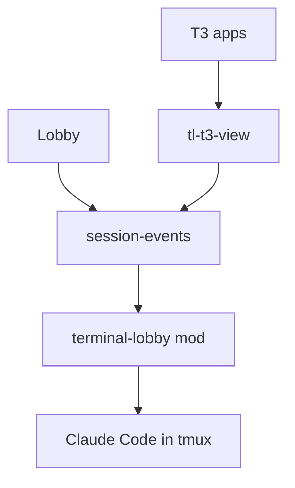
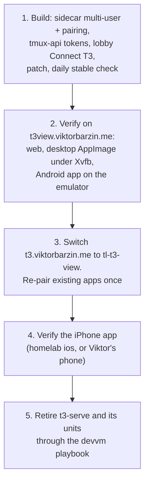

# T3 everywhere: T3's apps as clients of lobby sessions

**Status:** design agreed 2026-10-21, not yet built · **ADR:**
[0045](../adr/0045-t3-apps-are-clients-of-lobby-sessions.md) · **Builds on:**
[ADR-0044](../adr/0044-t3-code-renders-a-session-through-its-own-protocol.md)
and the [T3 view design](2026-10-12-t3-view-design.md) · **Scope:** `t3-view/`,
`tmux-api`, `frontend-v2`, `release/` and CI in this repo; `stacks/t3code`,
`stacks/terminal`, `stacks/monitoring`, `stacks/k8s-portal` and
`playbooks/devvm.yml` in infra

Viktor, 2026-10-20: *"it would be good to be able to see t3 sessions in
terminal lobby and vice versa. so i can try out different UIs for the same
work."* Then: *"can't we use 1 for both? I'm worried we will end up maintaining
multiple stacks without a good reason."*

## Where we start from

| Fact | Evidence |
|---|---|
| The lobby already serves its sessions over T3's protocol | `tl-t3-view` on :7690, ADR-0044, released in 0.125.2 |
| That T3 view is inside the lobby only, admin-only, pinned to a nightly | `t3-view/T3_PIN` = `v0.0.46-nightly.20261011.2994`; ADR-0044 decision 12 |
| `t3-serve@wizard` runs `t3` 0.1.0, auto-updated from npm `latest` | `infra/scripts/t3-autoupdate.sh:53`; both speak protocol 2 |
| Viktor's T3 Claude provider points at a binary that no longer exists | `~/.t3/userdata/settings.json`: `claudeAgent` → `/usr/local/bin/tl-t3-bridge`, removed by ADR-0029 |
| One T3 client can show several servers in one sidebar | `docs/internals/remote.md`, `Sidebar.tsx` at `v0.1.0` |
| Native apps reach one user's `t3 serve` only | `infra/stacks/t3code/main.tf:99-120`: the app fetches the environment descriptor before it has a credential |
| T3's phone push goes through T3's hosted relay only | `apps/server/src/relay/AgentAwarenessRelay.ts`; the relay holds the APNs and FCM keys for the store apps |

```stats
0 | T3 messages since 2026-09-19 (wizard)
999 | of 1,013 wizard T3 threads ran through the old bridge
7 | T3 threads for emo, last 2026-07-28
+275/−20 | contract lines, Oct pin → v0.1.0
```

## The shape

One host, one server. Every Claude runs as a lobby session in tmux, through the
mod (ADR-0036). Every T3 client connects to `tl-t3-view` and nothing else.



"T3 apps" is the web app at `t3.viktorbarzin.me`, the desktop app and the
phone app. `tl-t3-view` asks tmux-api who each caller is. The lobby keeps its
Terminal, Text and T3 views.

A thread started in any T3 client becomes a lobby session (ADR-0044 decision
21), so it has a Terminal view, a Text view and a T3 view in the lobby from its
first prompt. A session started in the lobby shows in every T3 client's sidebar.

## Decisions

| # | Question | Decision |
|---|---|---|
| 1 | The unit | A session is one Claude conversation. The lobby is the only host |
| 2 | Driving | One live process, drivable from every surface at once |
| 3 | Clients | T3 web, desktop and phone apps, and the lobby's own views |
| 4 | Users | Every lobby user (today wizard and emo). The T3 view drops its admin-only gate |
| 5 | Starting a session | Unchanged on both sides |
| 6 | Address | `t3.viktorbarzin.me` serves `tl-t3-view` and the T3 web build. `t3view.viktorbarzin.me` redirects there |
| 7 | Browser auth | Authentik forward-auth, as today; `tl-t3-view` checks the identity through tmux-api `/whoami` |
| 8 | Native auth | T3's pairing flow. A "Connect T3" item in the lobby shows a pairing link and QR code. tmux-api mints the code, exchanges it for a bearer token at `/oauth/token`, and checks the token on every request and WebSocket ticket. The lobby lists tokens by device and revokes them |
| 9 | Native route | An Authentik-less carve-out on `t3.viktorbarzin.me`, as `stacks/t3code` has today, pointed at `tl-t3-view`, with the rate-limit middleware kept |
| 10 | Environment id | One for all users, stable across restarts and upgrades |
| 11 | Harnesses | Claude only |
| 12 | T3 chrome | The patch gains a lobby-server mode that hides the controls `tl-t3-view` does not serve (terminal panel, git and worktree actions, provider settings, other providers), full-page and embedded |
| 13 | Upstream | Latest stable. A daily lobby CI job compares T3's latest GitHub release with the pin (npm versions have not always had a matching git tag), rebuilds the web client and sidecar, runs the typecheck and the recorded-session tests, and on success lands the new pin and releases |
| 14 | A failing release | Held: the pin stays on the last release that passed, and Slack #alerts names the held version and links the workflow run that shows the failing step |
| 15 | Notifications | Desktop and web T3 raise their own from the stream; the sidecar keeps run status, pending requests and completion accurate. Phones keep lobby push. No T3 relay |
| 16 | Retirement | `t3-serve@`, `t3-dispatch`, `t3-autoupdate`, `t3-watchdog`, `t3-migrate-idle`, `t3-provision-users`, `t3-cgroup-snap` and the `t3-backup-state` timer leave the devvm playbook. Each user's last `~/.t3` backup is kept. `t3-afk` is not touched |
| 17 | Rollout | Staged (below) |

## What changes where

| Where | Change |
|---|---|
| `t3-view/` (sidecar) | Serves every lobby user. Adds `/oauth/token` and `/api/auth/websocket-ticket` backed by tmux-api. Accepts a bearer token from any origin on the native routes, and keeps the same-origin check for cookie-authenticated browsers. Serves the descriptor with the fixed environment id |
| `t3-view/patches` | Lobby-server mode, decision 12. `EMBED.md` documents it |
| `tmux-api` | Pairing codes (short-lived, single use), bearer tokens (hashed at rest, per device label), a check endpoint for the sidecar, list and revoke |
| `frontend-v2` | "Connect T3" with link and QR code; the device list; the T3 view offered to every user |
| `release/` and CI | The daily stable check and hold, decisions 13 and 14. `T3_PIN` names a stable tag from then on |
| `infra/stacks/t3code` | `t3.viktorbarzin.me` routes to `tl-t3-view` for browsers and native clients; `t3-dispatch` and the `t3-native` service go |
| `infra/stacks/terminal` | `t3view` becomes a redirect |
| `infra/stacks/monitoring` | The `t3-dispatch` Loki alerts go; the walloff probes point at the new routes |
| `infra/stacks/k8s-portal` | Its pages call `t3.viktorbarzin.me` a "web terminal"; the copy changes to match |
| `infra/playbooks/devvm.yml` | The units in decision 16 are removed at the final stage |

## Rollout



Each stage is checked through the client a person would use: a session started
in the lobby is opened and driven from the T3 client, a thread started in the T3
client is opened in the lobby's Terminal view, and a reply typed on one side
appears live on the other.

| Client | How it is verified here |
|---|---|
| T3 web | Playwright against the real URL, screenshot read back |
| T3 desktop | `T3-Code-<version>-x86_64.AppImage` from T3's GitHub release, under Xvfb |
| T3 Android | The shared emulator over adb. There is no Play Store on that image, so a release APK from GitHub |
| T3 iPhone | The App Store app through `homelab ios`, which was down on 2026-10-20 (no tunnel to the phone, Mac unreachable), or Viktor on his own phone |

## What we did not do

| Option | Why not |
|---|---|
| Two hosts: T3 threads under `t3 serve`, lobby sessions in tmux, each listing and driving the other | Three mechanisms (the mod inside T3's Claude, T3's MCP for sends, `tl-t3-view`) and two stacks to keep in step |
| A merged proxy in front of `t3 serve` | Merges two snapshot and sequence streams on a protocol the lobby does not control |
| ACP | The most stable seam, but T3 imports ACP sessions by hand and does not draw turns it did not start |
| A provider binary and list sync | ADR-0009's shape, removed by ADR-0029 |
| T3 app push through T3's relay | Needs a T3 Connect account per user and one hostname per user, and sends thread and project titles to T3's relay on every state change |

## Open questions

- How the sidecar names a bearer-authenticated user on its calls to
  session-events. ADR-0044 relays the identity header and proxy secret that
  Traefik set on a browser request; a native request has a token instead. Either
  the sidecar sets the identity from tmux-api's answer, which makes it able to
  name any user, or it forwards the token and session-events checks it with
  tmux-api too. The second keeps the sidecar holding no authority of its own.
  To be settled in implementation planning.
- Whether a stable T3 client and a sidecar built on the same stable's contracts
  agree beyond the protocol number. Expected, and checked at the first stable
  bump.
- Whether the desktop app raises notifications while its window is in the
  background. Not yet observed.
- Which Android APK variant T3's releases ship, and whether it works against a
  server it was not built with. Checked at stage 2.
