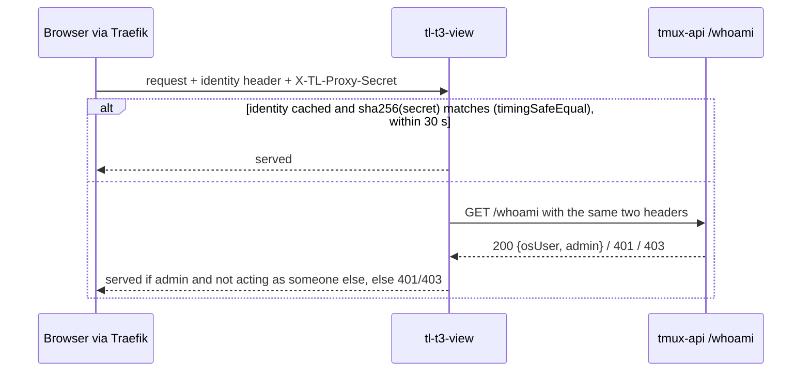

# tl-t3-view

`tl-t3-view` serves T3 Code's web client against lobby sessions. It hosts an
unmodified T3 web build (plus the patches in `patches/`) and implements T3's
orchestration protocol v2 with T3's own `packages/contracts`, so the web
client treats it as a T3 server. Design: [ADR-0044](../docs/adr/0044-t3-code-renders-a-session-through-its-own-protocol.md)
and [the T3 view design](../docs/plans/2026-10-12-t3-view-design.md). What the
real client asks of its server was measured in [TRACE.md](TRACE.md).

Status: stage 2 (skeleton). The web client boots without the first-run wizard
and shows one placeholder project. Lobby sessions, the read path and commands
come in stages 3 and 4.

## Layout

| Path | What it is |
|---|---|
| `T3_PIN` | The T3 tag, its commit, and the repo to fetch it from |
| `patches/*.patch` | Applied to the pinned checkout in name order (none yet; the embed patch lands in stage 5) |
| `scripts/build-web.sh` | Extracts the pin, applies patches, installs T3's web closure from T3's lockfile, builds `apps/web`. CI runs the same script |
| `scripts/link-t3.sh` | Points `node_modules/` at that checkout. Generated, gitignored |
| `scripts/build-sidecar.sh` | Bundles `src/main.ts` with esbuild into one `tl-t3-view.mjs` for system node |
| `scripts/dev-proxy.mjs` | Plays Traefik for local browser testing (below) |
| `src/` | The sidecar |
| `test/` | vitest |
| `trace/`, `TRACE.md` | Stage 1 captures of the real T3 client and server |

## Building

```sh
W=<work dir outside the repo>            # needs about 1.5 GB
T3_REPO=~/src/t3code scripts/build-web.sh "$W"   # or --deps-only to skip the web build
scripts/link-t3.sh "$W"
npm test                                  # vitest, against T3's contracts
npm run typecheck                         # T3's own compiler options
scripts/build-sidecar.sh dist             # dist/tl-t3-view.mjs, about 2 MB
```

`build-web.sh --print-key` prints the artefact key: the pinned commit plus a
digest of `patches/`. The web build only needs rebuilding when that key
changes. On the devvm with a warm pnpm store, the whole script took 2 min 57 s
and peaked at 3.3 GB RSS (`PNPM_STORE_DIR` reuses a store).

There is no second lockfile. `effect` (4.0.2 with T3's patch), `@effect/platform-node`,
esbuild, vitest and TypeScript 7 all come from T3's `pnpm-lock.yaml` at the pin.
`link-t3.sh` also links two app packages for single files that import only
contracts: `t3` (the server's `auth/RpcAuthorization.ts`) and `@t3tools/web`
(the first-run gate logic, in tests). Because the web-only install leaves
`apps/server` without `node_modules`, the script gives it `effect` and
`@t3tools/contracts` inside the generated checkout.

## Running

Environment variables only:

| Variable | Default | Meaning |
|---|---|---|
| `TL_T3_VIEW_BIND` | `127.0.0.1` | Listen address (production: `10.0.10.10`, for Traefik) |
| `TL_T3_VIEW_PORT` | `7690` | Listen port |
| `TL_AUTH_HEADER` | `X-Authentik-Username` | Identity header name, shared with every lobby service |
| `TL_T3_VIEW_TMUX_API` | `http://127.0.0.1:7684` | tmux-api |
| `TL_T3_VIEW_SESSION_EVENTS` | `http://127.0.0.1:7685` | session-events (used from stage 3) |
| `TL_T3_VIEW_WEB_DIR` | `/usr/lib/terminal-lobby/tl-t3-view/web` | The built web client |
| `TL_T3_VIEW_LABEL` | host name | The environment's name in T3 |

The sidecar refuses to start when `TL_PROXY_SECRET` is set (see the next
section). The systemd unit can read both lobby config files, so it gets the
same `TL_AUTH_HEADER` as tmux-api, and drop the secret with
`UnsetEnvironment=TL_PROXY_SECRET`.

### Local browser check

```sh
umask 077; sudo sed -n 's/^TL_PROXY_SECRET=//p' /etc/terminal-lobby.local.conf > "$W/proxy-secret"
TL_T3_VIEW_PORT=17690 TL_T3_VIEW_WEB_DIR="$W/web" node dist/tl-t3-view.mjs &
node scripts/dev-proxy.mjs --listen 127.0.0.1:17691 --target 127.0.0.1:17690 \
  --identity <an identity that maps to an admin> --secret-file "$W/proxy-secret" &
# open http://127.0.0.1:17691/
```

The proxy adds the identity header and the real proxy secret to every request
and WebSocket upgrade, as Traefik's middleware does. The sidecar then checks
them with the production tmux-api.

## Inbound auth

The devvm's nftables accept loopback and 10.0.10.10, so every local OS user
can reach the sidecar's port. The identity header alone proves nothing there.
The lobby's control is the proxy secret: Traefik adds `X-TL-Proxy-Secret`, and
the Go services compare it with `TL_PROXY_SECRET`
([authuser/resolve.go](../authuser/resolve.go)).

The sidecar verifies the secret without holding it:



- Every route goes through the gate, including static files and the `/ws`
  upgrade. A refused caller gets 401 or 403 before routing, so it does not
  learn which paths exist or which protocol version the sidecar speaks.
- tmux-api does the secret comparison, so the secret stays in tmux-api's
  environment only. The sidecar's cache holds a SHA-256 digest of an admitted
  secret, keyed by identity, for 30 seconds. A later request is admitted from
  the cache only when the digest of the secret it presents matches, compared
  with `timingSafeEqual`.
- Refusals are never cached. A burst of concurrent requests for the same pair
  (a page load fetches about 280 assets) shares one `/whoami` call.
- Only admins are admitted (`/whoami`'s `admin`), and an answer that carries
  `realUser` (acting as someone else) is refused.
- tmux-api unreachable: 502.
- The secret a request presented travels with its `Identity`, because later
  stages relay the identity header and the secret on every call to
  session-events and tmux-api, as the browser's own calls do. It lives as long
  as the request or WebSocket that brought it.

Caches of lobby data (stage 3) are keyed by (OS user, session).

## Protocol

| Route | Answer |
|---|---|
| `GET /.well-known/t3/environment` | Descriptor, `orchestrationProtocolVersion: 2`, a host-derived stable `environmentId` |
| `GET /api/auth/session` | `authenticated: true`; permissions `orchestration:read`, `orchestration:operate`, `filesystem:read` |
| `GET /api/orchestration/shell` | Shell snapshot; 400 without `x-t3-orchestration-protocol: 2` |
| `POST /api/observability/v1/traces` | 204 (the client posts traces unconditionally) |
| `GET /ws?orchestrationProtocol=2` | Effect RPC, `RpcSerialization.layerJson`; 426 on any other version |
| `GET *` | The web build; `index.html` for app routes; other `/api/`, `/ws`, `/.well-known/` paths 404 |

RPC (`src/rpc/`):

- `stubs.ts` has a default for all 193 RPCs of `WsRpcGroup` at the pin. A unary
  RPC dies with "tl-t3-view does not serve <tag>" and logs a warning; a
  subscription stays open and silent, because the client re-raises a failed
  subscription. Keys are written out, so a pin bump that adds an RPC is a type
  error in `handlers.ts`, and one that removes an RPC fails `test/stubs.test.ts`.
- `handlers.ts` has the real handlers: config, lifecycle, probe, shell,
  archived shell, `thread.visit`, and honest empty answers for what the client
  calls unprompted (previews, VCS status, refs, source control, scheduled
  tasks, project clones, file metadata, `t3.json`, project favicons).
- `authorization.ts` is T3's own `RpcScopeAuthorization` table applied to the
  granted permissions, so terminal RPCs and source-control writes fail before
  any handler runs. Refusals are logged with the RPC tag.

The granted permissions leave out `terminal:*` and `source-control:write`, but
the client still draws the terminal drawer toggle (TRACE.md finding 1); the
embed patch hides it.

### Sequence numbers

The client caches threads in IndexedDB and resumes with the last sequence it
applied, dropping any event at or below it. One process-wide clock starts at
the startup time in microseconds (`SequenceClock`), so a restart starts above
any sequence an earlier run handed out. `EventLog.resume` answers a resume from
another run, from ahead of this run, or from before events already dropped
with a full snapshot.

## Extension points

- Read path (stage 3): `SidecarDeps.shell` in `src/server.ts` and
  `ConnectionContext` in `src/rpc/handlers.ts` take the user's lobby projects
  and Claude sessions. `subscribeShell`, `subscribeThread`,
  `getThreadProjection` and `GET /api/orchestration/threads/:id/bounded` read
  from there, with sequences from the shared `SequenceClock` and replay from an
  `EventLog` per stream.
- Commands (stage 4): `orchestration.dispatchCommand` (all types other than
  `thread.visit` are unserved today) and `orchestration.launchThread`, calling
  session-events and tmux-api with `identity.relay`.
- Models: `src/models.ts` mirrors the Claude rows of
  `frontend-v2/src/lib/models.ts`.

## Open questions

- Whether the web client behaves well when a unary call it makes later dies
  (only boot and an idle draft page were exercised in stage 2).
- Touch input, the soft keyboard and iOS Safari inside a cross-origin iframe
  are unverified; the phone check so far is a resized desktop Chromium.
