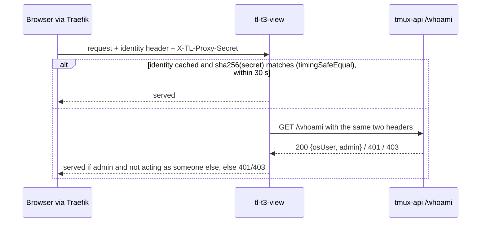
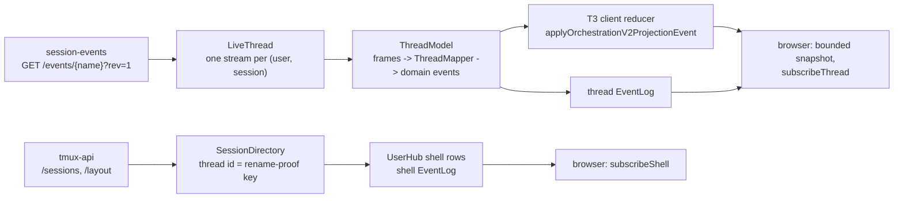

# tl-t3-view

`tl-t3-view` serves T3 Code's web client against lobby sessions. It hosts an
unmodified T3 web build (plus the patches in `patches/`) and implements T3's
orchestration protocol v2 with T3's own `packages/contracts`, so the web
client treats it as a T3 server. Design: [ADR-0044](../docs/adr/0044-t3-code-renders-a-session-through-its-own-protocol.md)
and [the T3 view design](../docs/plans/2026-10-12-t3-view-design.md). What the
real client asks of its server was measured in [TRACE.md](TRACE.md).

Status: built on branch, first cut, not released. The shell lists the user's
Claude sessions grouped as the lobby groups them, a thread renders from the
session's lobby stream, and sends, steers, queued messages, Stop, dialog
answers, mode, model and new threads go back to the lobby. History paging and
images are the second cut.

## Layout

| Path | What it is |
|---|---|
| `T3_PIN` | The T3 tag, its commit, and the repo to fetch it from |
| `patches/*.patch` | Applied to the pinned checkout in name order (one today, `embed.patch`; its contract is [EMBED.md](EMBED.md)) |
| `scripts/build-web.sh` | Extracts the pin, applies patches, installs T3's web closure from T3's lockfile, builds `apps/web`. CI runs the same script |
| `scripts/link-t3.sh` | Points `node_modules/` at that checkout. Generated, gitignored |
| `scripts/build-sidecar.sh` | Bundles `src/main.ts` with esbuild into one `tl-t3-view.mjs` for system node |
| `scripts/dev-proxy.mjs` | Plays Traefik for local browser testing (below) |
| `src/` | The sidecar |
| `test/` | vitest |
| `trace/`, `TRACE.md` | Stage 1 captures of the real T3 client and server |

## Building

```sh
W=<work dir outside the repo>            # needs about 1.5 GB
T3_REPO=~/src/t3code scripts/build-web.sh "$W"   # or --deps-only to skip the web build
scripts/link-t3.sh "$W"
npm test                                  # vitest, against T3's contracts
npm run typecheck                         # T3's own compiler options
scripts/build-sidecar.sh dist             # dist/tl-t3-view.mjs, about 2 MB
```

`build-web.sh --print-key` prints the artefact key: the pinned commit plus a
digest of `patches/`. The web build only needs rebuilding when that key
changes. On the devvm with a warm pnpm store, the whole script took 2 min 57 s
and peaked at 3.3 GB RSS (`PNPM_STORE_DIR` reuses a store).

There is no second lockfile. `effect` (4.0.2 with T3's patch), `@effect/platform-node`,
esbuild, vitest and TypeScript 7 all come from T3's `pnpm-lock.yaml` at the pin.
`link-t3.sh` also links two app packages for single files that import only
contracts: `t3` (the server's `auth/RpcAuthorization.ts`) and `@t3tools/web`
(the first-run gate logic, in tests). Because the web-only install leaves
`apps/server` without `node_modules`, the script gives it `effect` and
`@t3tools/contracts` inside the generated checkout.

## Running

Environment variables only:

| Variable | Default | Meaning |
|---|---|---|
| `TL_T3_VIEW_BIND` | `127.0.0.1` | Listen address (production unit: `0.0.0.0`, so Traefik reaches 10.0.10.10 and the release probe reaches loopback) |
| `TL_T3_VIEW_PORT` | `7690` | Listen port |
| `TL_AUTH_HEADER` | `X-Authentik-Username` | Identity header name, shared with every lobby service |
| `TL_T3_VIEW_TMUX_API` | `http://127.0.0.1:7684` | tmux-api |
| `TL_T3_VIEW_SESSION_EVENTS` | `http://127.0.0.1:7685` | session-events (used from stage 3) |
| `TL_T3_VIEW_WEB_DIR` | `/usr/lib/terminal-lobby/tl-t3-view/web` | The built web client |
| `TL_T3_VIEW_LABEL` | host name | The environment's name in T3 |
| `TL_T3_VIEW_STATE_DIR` | `$STATE_DIRECTORY` (systemd), else none | Where prompts awaiting their row (`pending.json`), the thread ids of sessions T3 created (`aliases.json`) and the prompts a T3 Stop held (`held.json`) outlive a restart; without it they are kept in memory |

The sidecar refuses to start when `TL_PROXY_SECRET` is set (see the next
section). The systemd unit can read both lobby config files, so it gets the
same `TL_AUTH_HEADER` as tmux-api, and drop the secret with
`UnsetEnvironment=TL_PROXY_SECRET`.

### Local browser check

```sh
umask 077; sudo sed -n 's/^TL_PROXY_SECRET=//p' /etc/terminal-lobby.local.conf > "$W/proxy-secret"
TL_T3_VIEW_PORT=17690 TL_T3_VIEW_WEB_DIR="$W/web" node dist/tl-t3-view.mjs &
node scripts/dev-proxy.mjs --listen 127.0.0.1:17691 --target 127.0.0.1:17690 \
  --identity <an identity that maps to an admin> --secret-file "$W/proxy-secret" &
# open the http://127.0.0.1:17691/?token=... link the proxy prints on stderr
```

The proxy adds the identity header and the real proxy secret to every request
and WebSocket upgrade, as Traefik's middleware does. The sidecar then checks
them with the production tmux-api.

Whoever gets through the proxy acts as that identity, with the real secret,
and every OS user on the devvm can reach a loopback port. So the proxy mints a
random token at startup and prints a link carrying it, once. Opening the link
sets an HttpOnly cookie for that port, and the proxy answers 401 to every
request and upgrade without it, forwarding nothing. Keep the link to
yourself, and stop the proxy when the check is done. Prefer an identity that
maps to a throwaway admin over your own where one exists.

## Inbound auth

The devvm's nftables accept loopback and 10.0.10.10, so every local OS user
can reach the sidecar's port. The identity header alone proves nothing there.
The lobby's control is the proxy secret: Traefik adds `X-TL-Proxy-Secret`, and
the Go services compare it with `TL_PROXY_SECRET`
([authuser/resolve.go](../authuser/resolve.go)).

The sidecar verifies the secret without holding it:



- Every route goes through the gate, including static files and the `/ws`
  upgrade. A refused caller gets 401 or 403 before routing, so it does not
  learn which paths exist or which protocol version the sidecar speaks.
- tmux-api does the secret comparison, so the secret stays in tmux-api's
  environment only. The sidecar's cache holds a SHA-256 digest of an admitted
  secret, keyed by identity, for 30 seconds. A later request is admitted from
  the cache only when the digest of the secret it presents matches, compared
  with `timingSafeEqual`.
- Refusals are never cached. A burst of concurrent requests for the same pair
  (a page load fetches about 280 assets) shares one `/whoami` call.
- Only admins are admitted (`/whoami`'s `admin`), and an answer that carries
  `realUser` (acting as someone else) is refused.
- tmux-api unreachable: 502.
- The `/ws` upgrade must carry an `Origin` whose host is the request's `Host`,
  or it gets 403, as session-events' `sameOrigin` does (`src/origin.ts`). The
  Authentik cookie covers the whole `viktorbarzin.me` site, so a page on any
  sibling host would otherwise reach the gate with the admin's identity. A
  write whose `Sec-Fetch-Site` names another origin is refused the same way.
- The secret a request presented travels with its `Identity`, because later
  stages relay the identity header and the secret on every call to
  session-events and tmux-api, as the browser's own calls do. It lives as long
  as the request or WebSocket that brought it.

Caches of lobby data are keyed by OS user first (`src/hub.ts` keeps one
`UserHub` per OS user), and a live thread by (OS user, thread id).

## Protocol

| Route | Answer |
|---|---|
| `GET /.well-known/t3/environment` | Descriptor, `orchestrationProtocolVersion: 2`, a host-derived stable `environmentId` |
| `GET /.well-known/t3/thread/:key` | The user's thread id for the key the lobby frames a session by; 404 when none |
| `GET /.well-known/t3/session/:threadId` | The other way: `{ key, name }`, the lobby key and the session's name now, for one of the user's own threads; 404 for someone else's or an unknown one. The embed patch's `tl-route` reports use it |
| `GET /api/auth/session` | `authenticated: true`; permissions `orchestration:read`, `orchestration:operate`, `filesystem:read` |
| `GET /api/orchestration/shell` | Shell snapshot; 400 without `x-t3-orchestration-protocol: 2` |
| `GET /api/orchestration/threads/:id/bounded` | The thread's projection; the window is the whole projection for now (`hasMoreHistory: false`); 404 for a thread the lobby does not list |
| `GET /api/orchestration/threads/:id/history` | An empty page: there is no older history to fetch until paging lands |
| `POST /api/observability/v1/traces` | 204 (the client posts traces unconditionally) |
| `GET /ws?orchestrationProtocol=2` | Effect RPC, `RpcSerialization.layerJson`; 426 on any other version |
| `GET *` | The web build; `index.html` for app routes, and a 302 to the thread's id for `/{environmentId}/{key}` named by another key; other `/api/`, `/ws`, `/.well-known/` paths 404 |

RPC (`src/rpc/`):

- `stubs.ts` has a default for all 193 RPCs of `WsRpcGroup` at the pin. A unary
  RPC dies with "tl-t3-view does not serve <tag>" and logs a warning; a
  subscription stays open and silent, because the client re-raises a failed
  subscription. Keys are written out, so a pin bump that adds an RPC is a type
  error in `handlers.ts`, and one that removes an RPC fails `test/stubs.test.ts`.
- `handlers.ts` has the real handlers: config, lifecycle, probe, shell,
  archived shell, `thread.visit`, and honest empty answers for what the client
  calls unprompted (previews, VCS status, refs, source control, scheduled
  tasks, project clones, file metadata, `t3.json`, project favicons).
- `authorization.ts` is T3's own `RpcScopeAuthorization` table applied to the
  granted permissions, so terminal RPCs and source-control writes fail before
  any handler runs. Refusals are logged with the RPC tag.

The granted permissions leave out `terminal:*` and `source-control:write`, but
the client still draws the terminal drawer toggle (TRACE.md finding 1); the
embed patch hides it.

### Sequence numbers

The client caches threads in IndexedDB and resumes with the last sequence it
applied, dropping any event at or below it. One process-wide clock starts at
the startup time in microseconds (`SequenceClock`), so a restart starts above
any sequence an earlier run handed out. `EventLog.resume` answers a resume from
another run, from ahead of this run, or from before events already dropped
with a full snapshot.

## Read path



- Thread ids (`src/shell/directory.ts`): a session's birth name (`bornAs`),
  else for a hand-named session the name it had when first seen, followed by
  tmux's session id; a session T3 created keeps the id T3 minted for it
  (`src/shell/aliases.ts`); someone else's session is `<owner>~<key>`. The
  directory maps the id to the session's current name before every call.
- Grouping follows the lobby's sidebar: layout projects, a session's own
  `project`, Ungrouped, one System project for harness and Caller sessions,
  one project per owner for shared sessions. Claude sessions only. T3 merges
  projects that share a workspace root, so a project after the first in a
  folder gets that folder written with a leading `/.` per clash
  (`/./home/wizard`); Ungrouped keeps the plain path.
- `LiveThread` (`src/threads/live.ts`) keeps one upstream stream per (OS user,
  session), resumes it with `lastEventId` and `epoch`, follows renames through
  the directory on a 404, and rebuilds the model (clients get one snapshot)
  when `ready` names another log. At every `ready` it reads the mode off the
  pane (session-events `GET /pane`, as the Solid view does), since the `state`
  frame's mode can be stale. It closes 60 s after its last subscriber.
- `ThreadModel` (`src/threads/model.ts`) buffers `back` frames until `ready`,
  folds `state` (mode, model; the queue is reconciled at `ready`), and passes
  stored events and deltas to `ThreadMapper`. Its log starts at a floor taken
  from the clock, so a client holding a sequence from a rebuilt log gets a
  snapshot.
- `ThreadMapper` (`src/threads/mapper.ts`) is the lobby-to-T3 mapping. How
  the lobby's stream maps onto runs is described at the top of that file; the
  tool table is T3's own (`src/threads/tools.ts`). Held dialogs become live
  runtime requests keyed by the tool call (`request:<toolId>`).

Tests: `test/threadModel.test.ts` feeds SSE captures of scratch sessions
(`test/fixtures/lobby/`) through the model and checks the projections with
the semantic integrity rules ported from T3's testkit (`test/helpers/projection.ts`).

## Commands

`src/commands/dispatch.ts`; the table at the top of that file lists each T3
command and the lobby request it becomes. Every send records messageId -> text
first (`src/threads/pending.ts`), so the user row Claude writes comes back
under the browser's own message id. `deliveryIntent` is resolved with T3's own
rule (`src/commands/policy.ts`). Two lobby additions back this:

- session-events `POST /prompt {wait: true}` holds a prompt until the turn
  ends instead of steering it (`queue_after_active`), and the held and asking
  dialog bodies name their tool call.
- tmux-api `POST /sessions/claim {project}` places a new session in a layout
  project under the layout lock (`launchThread`).

A thread launched from T3 is put in the mode the person chose before its
first prompt is sent. A pre-warm slot starts in `bypassPermissions`, so the
sidecar asks `POST /model {mode}` until the walk applies (a pane still starting
answers `unreadable` for a few seconds), and fails the launch without sending
the prompt when it does not.

T3's Stop sends `run.interrupt` with `holdQueue`. The sidecar then stops the
turn with `POST /cancel {restoreQueue}`, so session-events hands its held
prompts back instead of sending them at the turn's end, and keeps them as
queued runs with `queueHeld: true`, as T3's own server does. `queue.resume`
sends them again with `wait`, oldest first, under their own runs and message
ids. While a run is held only the sidecar has its text, so cancelling or
editing it changes it there without a lobby call. The held set of each
thread is written to `held.json` (`src/threads/held.ts`, keyed by OS user and
thread id) whenever it changes. A model built again from the log (a sidecar
restart, a stream rebuild, a thread reopened after it went idle) reads the
hand-back as each prompt leaving the queue, so at its first `ready` it holds
those runs again, and makes a held run for a prompt the bounded log no
longer shows.

The composer's models are the lobby's catalogue (`src/models.ts`, a copy of
frontend-v2's) plus, as a row named by its slug, each model one of the user's
live sessions is on that the catalogue lacks (for example `claude-haiku-5-5`
from a pre-warm alias). A change is sent on `subscribeServerConfig` as
`providerStatuses`. A send's model selection is applied only when the
session's model was among the rows the user was offered, so the composer's
fallback default is never applied as a choice.

## Open questions

- History paging and images (second cut): the bounded snapshot carries the
  whole window the lobby's reverse open delivered (about 100 KB of events).
- Touch input, the soft keyboard and iOS Safari inside a cross-origin iframe
  are unverified; the phone check so far is a resized desktop Chromium.
